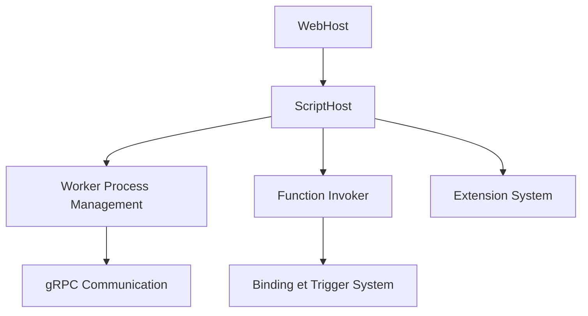

# Azure/azure-functions-host

> Code of the host runtime of the Azure Functions service, built on the WebJobs SDK.

## The problem
Running serverless functions in several languages with triggers and bindings requires a common host.

## What it actually does
The README stays brief: the repository contains the Azure Functions service host. According to the architecture, a WebHost drives a ScriptHost, which manages language workers (Node, Python, PowerShell) over gRPC, bindings, extensions, secrets, scaling and metrics.

## How it is wired
Diagram based on the provided diagram.



## Trying it
No command documented in the README, which refers to the wiki.
```bash
# non documenté dans le README ; voir le wiki
```

## Cost and gotchas
The Azure Functions service is billed by Microsoft; building the host yourself is an advanced case. More than 1,500 open issues.

## What it is not
Not a tool to install in order to write functions: it is the engine of the service, not its SDK.

## Alternatives
No alternative named in the README.

## For you
Ignore: you use Azure Functions without reading its host, except to contribute to the runtime.
