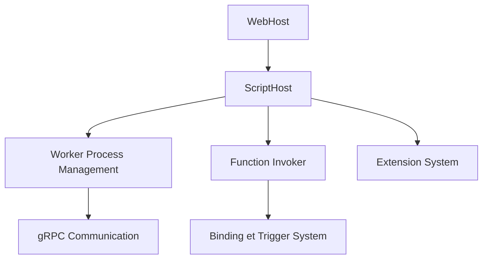

# Azure/azure-functions-host

> Code du runtime hôte du service Azure Functions, bâti sur le WebJobs SDK.

## Le problème
Exécuter des fonctions serverless en plusieurs langages avec triggers et bindings demande un hôte commun.

## Ce que ça fait vraiment
Le README reste bref : le dépôt contient l'hôte du service Azure Functions. D'après l'architecture, un WebHost pilote un ScriptHost, qui gère des workers de langage (Node, Python, PowerShell) en gRPC, les bindings, les extensions, les secrets, la mise à l'échelle et les métriques.

## Comment c'est branché
Schéma d'après le diagramme fourni.



## Essayer
Aucune commande documentée dans le README, qui renvoie au wiki.
```bash
# non documenté dans le README ; voir le wiki
```

## Coût et pièges
Le service Azure Functions est facturé par Microsoft ; compiler l'hôte soi-même est un cas avancé. Plus de 1 500 issues ouvertes.

## Ce que ce n'est pas
Pas un outil à installer pour écrire des fonctions : c'est le moteur du service, pas son SDK.

## Alternatives
Aucune alternative nommée dans le README.

## Pour toi
À ignorer : tu utilises Azure Functions sans en lire l'hôte, sauf pour contribuer au runtime.

