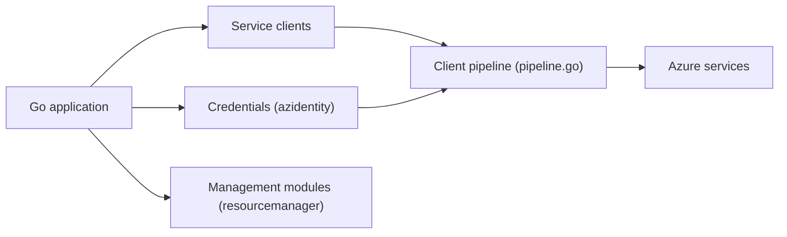

# Azure/azure-sdk-for-go

> Microsoft's official Go libraries for using and administering Azure services.

## The problem
Calling Azure services (storage, message bus, Cosmos, resources) from Go with consistent authentication, retries and logging.

## What it actually does
- "Client" modules (consume a service, e.g. upload a blob) and "management" modules (configure resources) in `/sdk`.
- Shared azcore core: HTTP pipeline, retries, logging, transport.
- Authentication through azidentity (Microsoft Entra ID).
- The old root module `services/**/mgmt/**` is deprecated.

## How it is wired


## Trying it
No explicit install command; the README provides a Go example that disables telemetry:
```go
clientOpts := policy.ClientOptions{
	Telemetry: policy.TelemetryOptions{Disabled: true},
}
```

## Cost and gotchas
The SDK is free, Azure resources are billed. Telemetry is enabled by default; it must be turned off for each client and each credential. 286 open issues.

## What it is not
Not a multi-cloud client. Beta modules are not for production.

## Alternatives
No alternative named in the README.

## For you
Adopt if you deploy on Azure with Go (MLOps tooling, operators): official SDK, actively maintained; otherwise not relevant.
