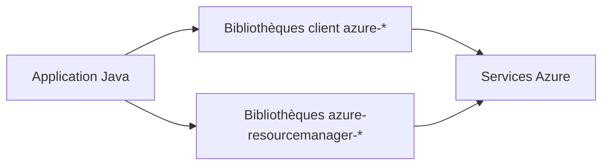

# Azure/azure-sdk-for-java

> Development repository of the Azure SDK for Java, for Java developers on Azure.

## The problem
Using and managing Azure services from Java with common conventions (retries, logs, authentication).

## What it actually does
Two families of libraries under `/sdk`: "client" (`azure-…`, to consume a service) and "management" (`azure-resourcemanager-…`, to configure resources). They share retries, logging, transports and authentication. Java 8 baseline, Maven group `com.azure`. The main branch is not the latest stable version.

## How it is wired

## Trying it
No command documented in the README: refer to the README of each library in `/sdk`.

## Cost and gotchas
Azure account required; services billed by Azure. Prefer stable non-beta versions for production. The old `com.microsoft.azure` group needs to be migrated.

## What it is not
Not an application nor an ML tool: a collection of access libraries.

## Alternatives
No alternative named in the README.

## For you
Keep an eye on it: relevant only if your stack is Java on Azure; in Python you will use another SDK that this repository does not cover.
