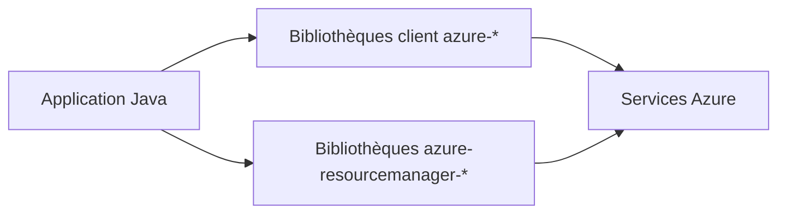

# Azure/azure-sdk-for-java

> Dépôt de développement du SDK Azure pour Java, destiné aux développeurs Java sur Azure.

## Le problème
Utiliser et gérer les services Azure depuis Java avec des conventions communes (retries, logs, authentification).

## Ce que ça fait vraiment
Deux familles de bibliothèques sous `/sdk` : « client » (`azure-…`, pour consommer un service) et « management » (`azure-resourcemanager-…`, pour configurer les ressources). Elles partagent retries, journalisation, transports et authentification. Base Java 8, Maven group `com.azure`. La branche principale n'est pas la dernière version stable.

## Comment c'est branché

## Essayer
Aucune commande documentée dans le README : se référer au README de chaque bibliothèque dans `/sdk`.

## Coût et pièges
Compte Azure requis ; services facturés par Azure. Préférer les versions stables non bêta pour la production. L'ancien groupe `com.microsoft.azure` est à migrer.

## Ce que ce n'est pas
Pas une application ni un outil ML : une collection de bibliothèques d'accès.

## Alternatives
Aucune alternative nommée dans le README.

## Pour toi
À surveiller : pertinent seulement si ta pile est Java sur Azure ; en Python tu utiliseras un autre SDK que ce dépôt ne couvre pas.

