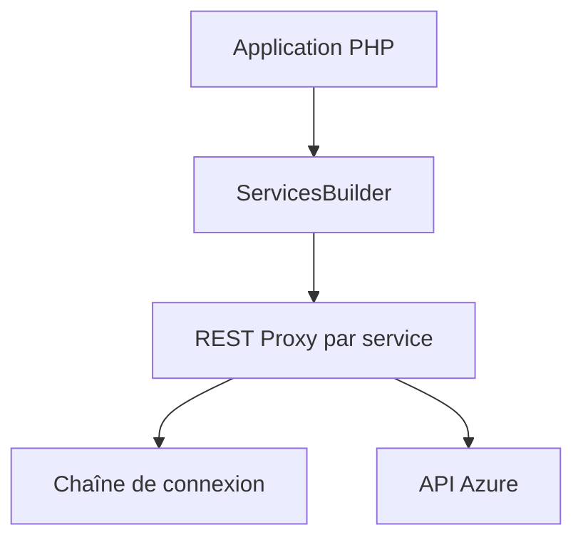

# Azure/azure-sdk-for-php

> PHP libraries to access Azure services (storage, service bus, management, media), abandoned since 2021.

## The problem
PHP applications needed clients to call Azure's REST APIs.

## What it actually does
The SDK exposes REST proxies for tables, blobs, storage queues, Service Bus, Service Runtime, Service Management and Media Services. It installs through Composer (`microsoft/windowsazure`). Since February 2021 the README states that the SDK is no longer supported and points to calling the REST API directly.

## How it is wired
Simplified diagram based on the sheet, no diagram provided.


## Trying it
```bash
git clone https://github.com/Azure/azure-sdk-for-php.git
cd ./azure-sdk-for-php
php composer.phar install
```

## Cost and gotchas
An Azure account and its keys are required, billed by Azure. The repository is archived, the last push dates from June 2023; the API versions cited are old (2011).

## What it is not
It is not a maintained SDK. Storage is tracked in another repository (azure-storage-php).

## Alternatives
- azure-storage-php: separate, maintained repository for storage.
- Calling the Azure REST API directly from PHP, recommended by the README.

## For you
Ignore: archived and unsupported, for PHP which is not your territory.
