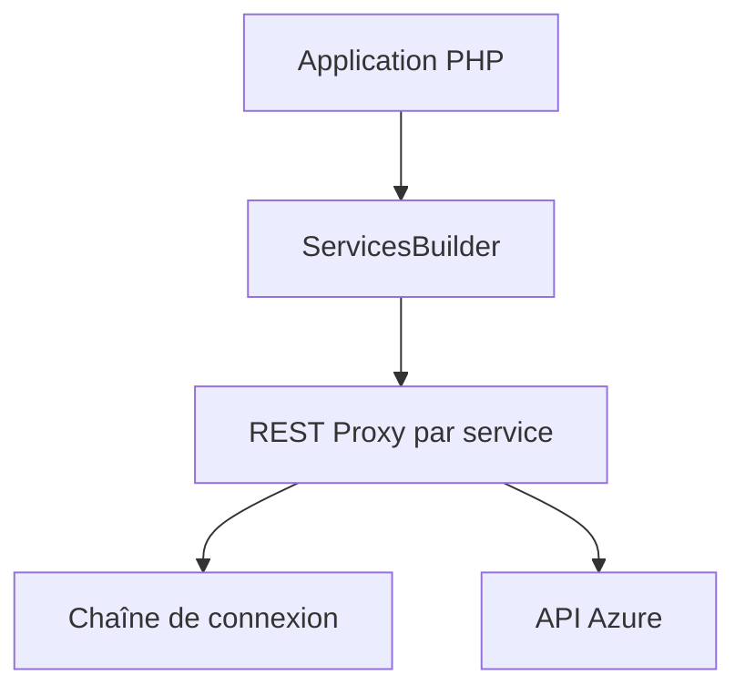

# Azure/azure-sdk-for-php

> Bibliothèques PHP pour accéder aux services Azure (stockage, bus de services, gestion, médias), à l'abandon depuis 2021.

## Le problème
Les applications PHP avaient besoin de clients pour appeler les API REST d'Azure.

## Ce que ça fait vraiment
Le SDK expose des proxys REST pour les tables, blobs, files de stockage, Service Bus, Service Runtime, Service Management et Media Services. Il s'installe par Composer (`microsoft/windowsazure`). Le README annonce depuis février 2021 que le SDK n'est plus supporté et renvoie vers l'appel direct de l'API REST.

## Comment c'est branché
Schéma simplifié d'après la fiche, sans diagramme fourni.


## Essayer
```bash
git clone https://github.com/Azure/azure-sdk-for-php.git
cd ./azure-sdk-for-php
php composer.phar install
```

## Coût et pièges
Un compte Azure et ses clés sont nécessaires, facturés par Azure. Le dépôt est archivé, le dernier push date de juin 2023 ; les versions d'API citées sont anciennes (2011).

## Ce que ce n'est pas
Ce n'est pas un SDK maintenu. Le stockage est suivi dans un autre dépôt (azure-storage-php).

## Alternatives
- azure-storage-php : dépôt séparé maintenu pour le stockage.
- Appel direct de l'API REST Azure en PHP, recommandé par le README.

## Pour toi
À ignorer : archivé et sans support, pour du PHP qui n'est pas ton terrain.

