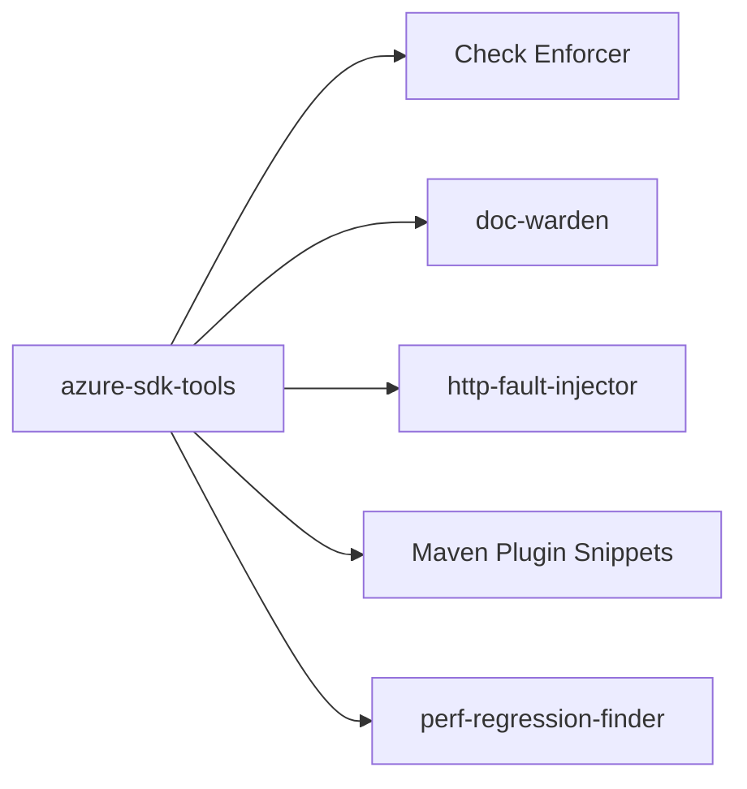

# Azure/azure-sdk-tools

> Internal toolbox of the Azure SDK team for its CI and repositories.

## The problem
A team maintaining SDKs in several languages needs shared tools for its checks, docs and tests.

## What it actually does
The README is an index of tools: Check Enforcer (GitHub checks in a mono-repo), a wiki index for the Azure SDK QA Bot, doc-warden (README standards), http-fault-injector (a proxy simulating HTTP failures), a Maven plugin for code snippets, pixel-server and perf-regression-finder. Several are marked as not enabled.

## How it is wired
Simplified diagram based on the sheet, no diagram provided.

## Trying it
No documented command: each tool has its own README.

## Cost and gotchas
Free. Tools tailored to Azure SDK infrastructure: their reuse outside that context is not documented. Check Enforcer lives in another repository.

## What it is not
Not an Azure SDK nor a data tool: internal tooling only.

## Alternatives
No alternative named in the README.

## For you
Ignore: internal tooling of an SDK team, with no link to a data, AI or MLOps path.
