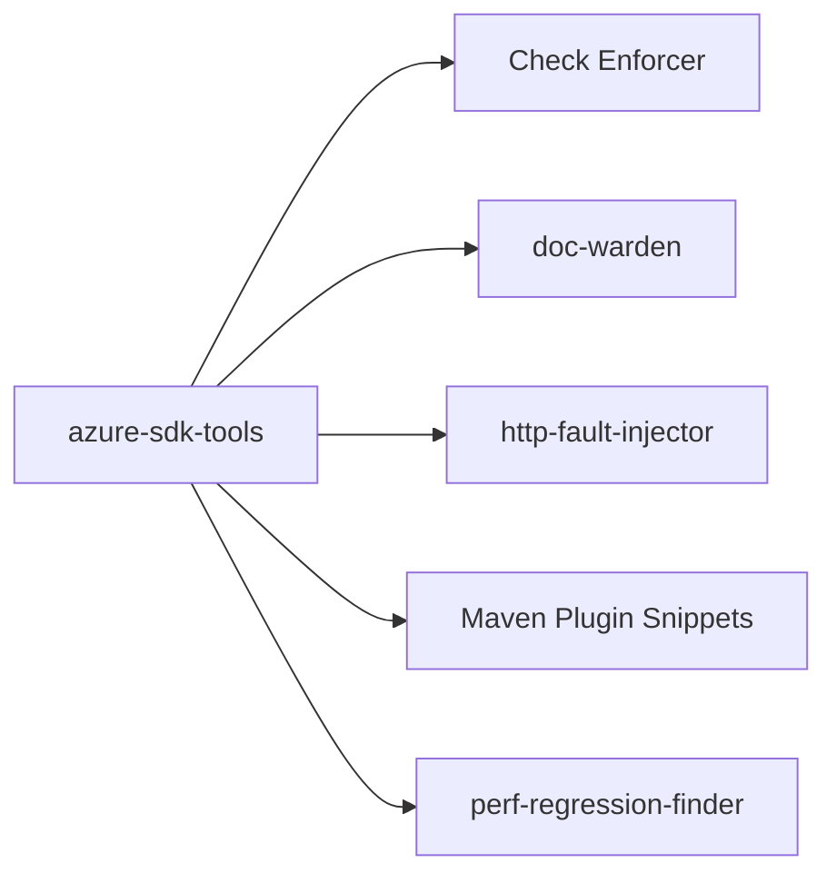

# Azure/azure-sdk-tools

> Boîte à outils interne de l'équipe Azure SDK pour sa CI et ses dépôts.

## Le problème
Une équipe qui maintient des SDK dans plusieurs langages a besoin d'outils communs pour ses checks, ses docs et ses tests.

## Ce que ça fait vraiment
Le README est un index d'outils : Check Enforcer (checks GitHub dans un mono-repo), un index de wiki pour le QA Bot Azure SDK, doc-warden (standards de README), http-fault-injector (proxy simulant des pannes HTTP), un plugin Maven pour les extraits de code, pixel-server et perf-regression-finder. Plusieurs sont marqués non activés.

## Comment c'est branché
Schéma simplifié d'après la fiche, sans diagramme fourni.

## Essayer
Aucune commande documentée : chaque outil a son propre README.

## Coût et pièges
Gratuit. Outils taillés pour l'infrastructure d'Azure SDK : leur réutilisation hors de ce contexte n'est pas documentée. Check Enforcer vit dans un autre dépôt.

## Ce que ce n'est pas
Pas un SDK Azure ni un outil de données : uniquement de l'outillage interne.

## Alternatives
Aucune alternative nommée dans le README.

## Pour toi
À ignorer : outillage interne d'une équipe SDK, sans lien avec un parcours data, IA ou MLOps.

