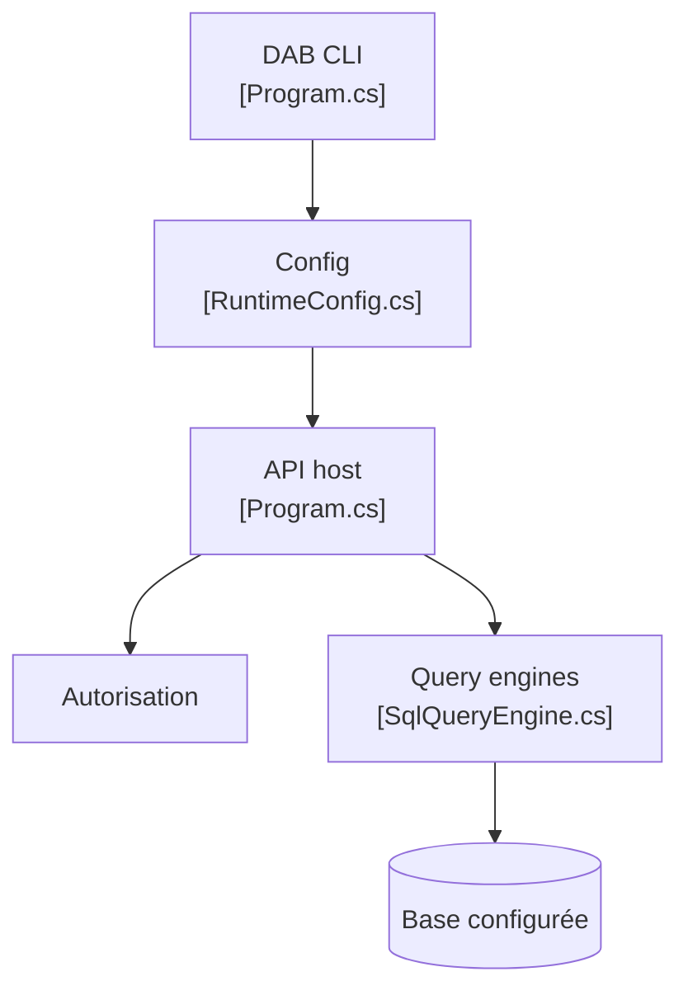

# Azure/data-api-builder

> No-code tool that exposes a database as a REST, GraphQL and MCP API, for developers.

## The problem
Hand-writing CRUD endpoints, their authorization and their translation into SQL is repetitive for every table.

## What it actually does
From a `dab-config.json` file describing entities and permissions, DAB reads the database metadata, starts an engine, authorizes each request, generates the SQL, runs it and returns JSON. It handles tables, views and stored procedures, with caching, a health endpoint, Swagger and an optional embeddings module.

## How it is wired


## Trying it
```bash
dotnet tool install microsoft.dataapibuilder -g
dab init --database-type mssql --connection-string "@env('my-connection-string')" --host-mode development
dab add Todo --source "dbo.Todo" --permissions "anonymous:*"
dab start
```

## Cost and gotchas
Free. You need .NET 8 or later and an accessible database. The tutorial's `anonymous:*` permission is open to everyone: restrict it. Nitro may store work in ChilliCream's cloud.

## What it is not
It is not a business logic layer: only CRUD. More than 550 open issues.

## Alternatives
No alternative named in the README.

## For you
Worth watching: handy for quickly exposing tables to a tool or an agent via REST or MCP, provided you lock down the permissions properly.
