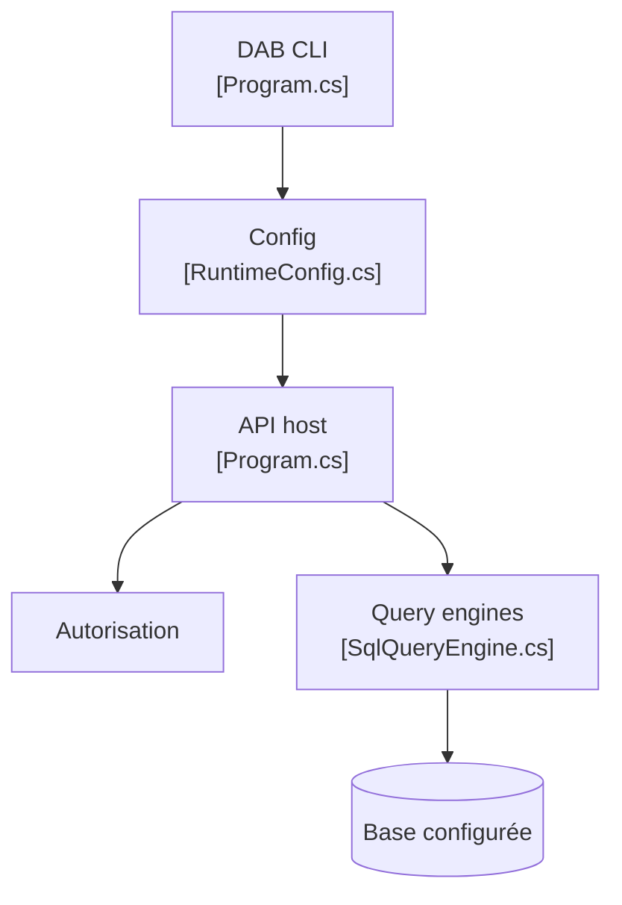

# Azure/data-api-builder

> Outil sans code qui expose une base de données en API REST, GraphQL et MCP, pour développeurs.

## Le problème
Écrire à la main des endpoints CRUD, leur autorisation et leur traduction en SQL est répétitif pour chaque table.

## Ce que ça fait vraiment
À partir d'un fichier `dab-config.json` décrivant entités et permissions, DAB lit les métadonnées de la base, démarre un moteur, autorise chaque requête, génère le SQL, l'exécute et renvoie du JSON. Il gère tables, vues et procédures stockées, avec cache, point de santé, Swagger et un module d'embeddings optionnel.

## Comment c'est branché


## Essayer
```bash
dotnet tool install microsoft.dataapibuilder -g
dab init --database-type mssql --connection-string "@env('my-connection-string')" --host-mode development
dab add Todo --source "dbo.Todo" --permissions "anonymous:*"
dab start
```

## Coût et pièges
Gratuit. Il faut .NET 8 ou plus et une base accessible. La permission `anonymous:*` du tutoriel est ouverte à tous : à restreindre. Nitro peut stocker du travail dans le cloud de ChilliCream.

## Ce que ce n'est pas
Ce n'est pas une couche de logique métier : seulement du CRUD. Plus de 550 issues ouvertes.

## Alternatives
Aucune alternative nommée dans le README.

## Pour toi
À surveiller : pratique pour exposer vite des tables à un outil ou un agent via REST ou MCP, à condition de bien verrouiller les permissions.

