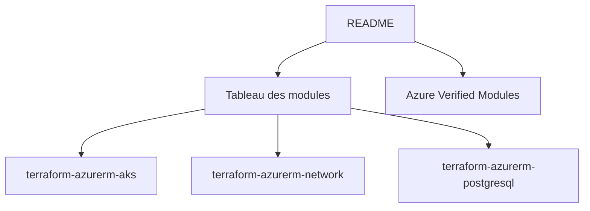

# Azure/terraform-azure-modules

> Index of the Terraform modules verified by Microsoft Azure, now merged into Azure Verified Modules.

## The problem
Finding the reference Azure Terraform modules and their minimum Terraform versions.

## What it actually does
A table of eight modules (aks, compute, loadbalancer, network, network-security-group, postgresql, subnets, virtual-machine) with module version, minimum Terraform version (1.2.0) and a link to their README. The README announces that the program is merging with Azure Verified Modules and that new modules will be created there.

## How it is wired
Simplified diagram based on the sheet, no diagram provided.

## Trying it
No command documented.

## Cost and gotchas
Free; the cost comes from the Azure resources the modules create.

## What it is not
Not Terraform code: only an index. The table's downloads are "xxxx", not filled in.

## Alternatives
Azure Verified Modules (AVM), cited in the README, for any new project.

## For you
Ignore: archived index, replaced by Azure Verified Modules.
