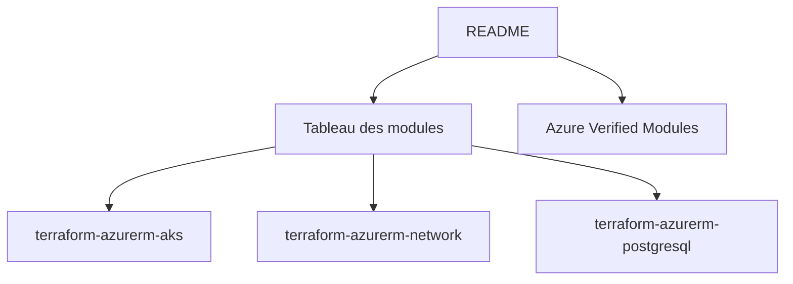

# Azure/terraform-azure-modules

> Index des modules Terraform vérifiés par Microsoft Azure, désormais fusionné dans Azure Verified Modules.

## Le problème
Retrouver les modules Terraform Azure de référence et leurs versions minimales de Terraform.

## Ce que ça fait vraiment
Un tableau de huit modules (aks, compute, loadbalancer, network, network-security-group, postgresql, subnets, virtual-machine) avec version du module, version minimale de Terraform (1.2.0) et lien vers leur README. Le README annonce que le programme fusionne avec Azure Verified Modules et que les nouveaux modules y seront créés.

## Comment c'est branché
Schéma simplifié d'après la fiche, sans diagramme fourni.

## Essayer
Aucune commande documentée.

## Coût et pièges
Gratuit ; le coût vient des ressources Azure que les modules créent.

## Ce que ce n'est pas
Pas du code Terraform : seulement un index. Les téléchargements du tableau sont des « xxxx », non remplis.

## Alternatives
Azure Verified Modules (AVM), cité dans le README, pour tout nouveau projet.

## Pour toi
À ignorer : index archivé, remplacé par Azure Verified Modules.

