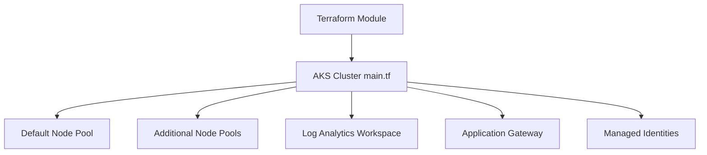

# Azure/terraform-azurerm-aks

> Terraform module to create an Azure Kubernetes Service cluster; being retired in favor of an AVM module.

## The problem
Declaring an AKS cluster with networking, monitoring, ingress and identities requires assembling many Terraform resources.

## What it actually does
The module creates an `azurerm_kubernetes_cluster` with node pools, a Log Analytics workspace, collection rules, role assignments, an application gateway for ingress and local DNS options. It exposes outputs to configure the Kubernetes provider. It requires Terraform 1.9+ and the azurerm, azapi, null, time and tls providers. An optional tracing tag (Yor) can be enabled.

## How it is wired



## Trying it
```bash
docker run --rm -v $(pwd):/src -w /src mcr.microsoft.com/azterraform:latest make pre-commit
docker run --rm -v $(pwd):/src -w /src mcr.microsoft.com/azterraform:latest make pr-check
```

## Cost and gotchas
Free; an Azure subscription and a service principal are required, and the cluster is billed. Major version changes break compatibility. The module is being retired: fixes until April, removal planned for May.

## What it is not
Not a durable module: it is archived and its successor is elsewhere. It is not an application deployment tool.

## Alternatives
Azure/avm-res-containerservice-managedcluster/azurerm: the replacement module named in the deprecation notice.

## For you
Ignore: retired, you need to migrate to the AVM module named in the README.
