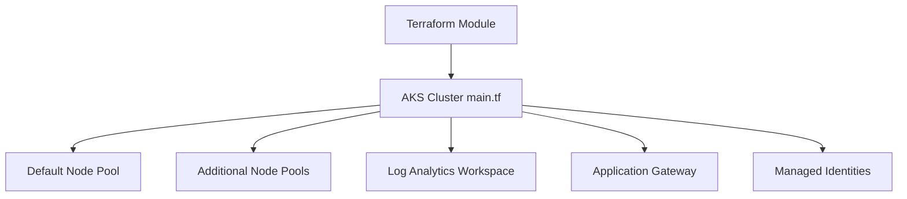

# Azure/terraform-azurerm-aks

> Module Terraform pour créer un cluster Azure Kubernetes Service ; en cours de retrait au profit d'un module AVM.

## Le problème
Déclarer un cluster AKS avec réseau, supervision, ingress et identités demande beaucoup de ressources Terraform à assembler.

## Ce que ça fait vraiment
Le module crée un `azurerm_kubernetes_cluster` avec pools de nœuds, espace Log Analytics, règles de collecte, attributions de rôles, passerelle applicative en entrée et options de DNS local. Il expose des sorties pour configurer le provider Kubernetes. Il requiert Terraform 1.9+ et les providers azurerm, azapi, null, time et tls. Une balise optionnelle de traçage (Yor) peut être activée.

## Comment c'est branché



## Essayer
```bash
docker run --rm -v $(pwd):/src -w /src mcr.microsoft.com/azterraform:latest make pre-commit
docker run --rm -v $(pwd):/src -w /src mcr.microsoft.com/azterraform:latest make pr-check
```

## Coût et pièges
Gratuit ; un abonnement Azure et un service principal sont nécessaires, et le cluster est facturé. Les changements de version majeure cassent la compatibilité. Le module est en retrait : correctifs jusqu'en avril, retrait prévu en mai.

## Ce que ce n'est pas
Pas un module durable : il est archivé et son successeur est ailleurs. Ce n'est pas un outil de déploiement d'applications.

## Alternatives
Azure/avm-res-containerservice-managedcluster/azurerm : le module de remplacement indiqué dans l'avis de dépréciation.

## Pour toi
À ignorer : retiré, il faut migrer vers le module AVM nommé dans le README.

