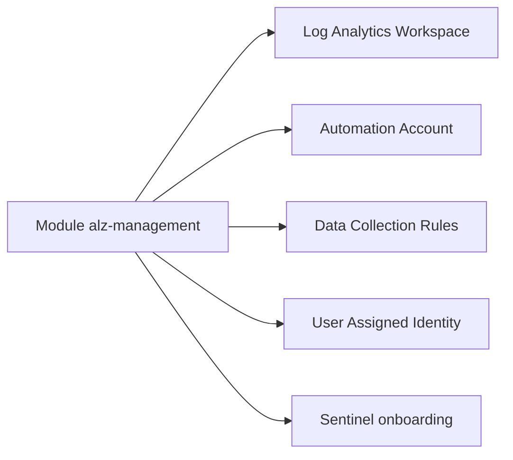

# Azure/terraform-azurerm-avm-ptn-alz-management

> Azure Verified Modules Terraform module that deploys the management resources of an Azure Landing Zone.

## The problem
An Azure Landing Zone needs a logging workspace, an automation account and collection rules, to be created in a consistent way.

## What it actually does
The module creates a Log Analytics Workspace, optionally an Automation account, a resource group, Log Analytics solutions, data collection rules (change tracking, VM insights, Defender SQL) and a managed identity. Sentinel onboarding is possible. It relies on the azurerm and azapi providers.

## How it is wired
Simplified diagram based on the fiche, no diagram provided.



## Trying it
```hcl
module "avm-ptn-alz-management" {
  source  = "Azure/avm-ptn-alz-management/azurerm"
  version = "<version>"

  automation_account_name      = "aa-prod-eus-001"
  location                     = "eastus"
  log_analytics_workspace_name = "law-prod-eus-001"
  resource_group_name          = "rg-management-eus-001"
}
```

## Cost and gotchas
You need an Azure subscription, Terraform 1.9 up to below 2.0, azapi ~> 2.12 and azurerm ~> 4.35. Microsoft telemetry is enabled by default (`enable_telemetry`); turn it off with `false`.

## What it is not
It is not a complete Landing Zone: only the management part. The Azure resources created are billed.

## Alternatives
No alternative named in the README.

## For you
Ignore: useful only for an Azure architect building a Landing Zone, outside the usual data / AI scope.
