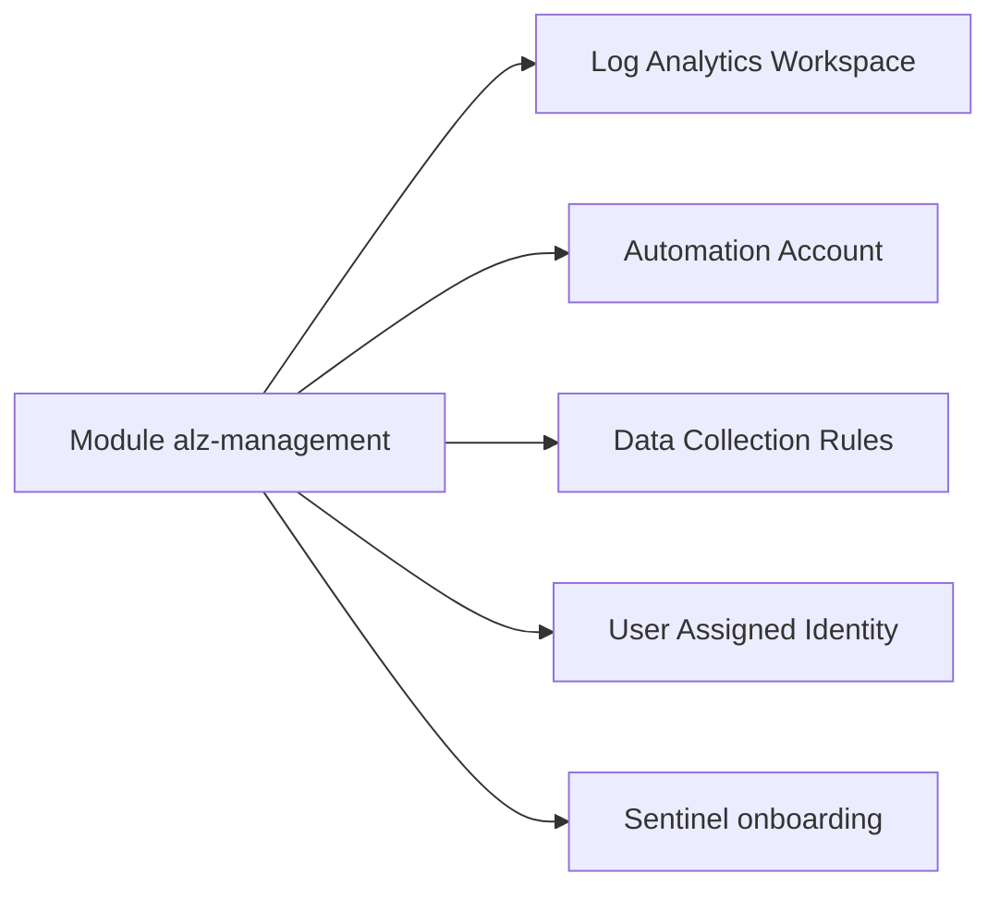

# Azure/terraform-azurerm-avm-ptn-alz-management

> Module Terraform Azure Verified Modules qui déploie les ressources de gestion d'une Azure Landing Zone.

## Le problème
Une Landing Zone Azure a besoin d'un espace de journalisation, d'un compte d'automatisation et de règles de collecte, à créer de façon homogène.

## Ce que ça fait vraiment
Le module crée un Log Analytics Workspace, en option un compte Automation, un groupe de ressources, des solutions Log Analytics, des règles de collecte de données (change tracking, VM insights, Defender SQL) et une identité managée. L'onboarding Sentinel est possible. Il s'appuie sur les providers azurerm et azapi.

## Comment c'est branché
Schéma simplifié d'après la fiche, sans diagramme fourni.



## Essayer
```hcl
module "avm-ptn-alz-management" {
  source  = "Azure/avm-ptn-alz-management/azurerm"
  version = "<version>"

  automation_account_name      = "aa-prod-eus-001"
  location                     = "eastus"
  log_analytics_workspace_name = "law-prod-eus-001"
  resource_group_name          = "rg-management-eus-001"
}
```

## Coût et pièges
Il faut un abonnement Azure, Terraform 1.9 à moins de 2.0, azapi ~> 2.12 et azurerm ~> 4.35. La télémétrie Microsoft est activée par défaut (`enable_telemetry`) ; elle se coupe avec `false`.

## Ce que ce n'est pas
Ce n'est pas une Landing Zone complète : seulement la partie gestion. Les ressources Azure créées sont facturées.

## Alternatives
Aucune alternative nommée dans le README.

## Pour toi
À ignorer : utile seulement pour un architecte Azure qui monte une Landing Zone, hors du périmètre data / IA courant.

