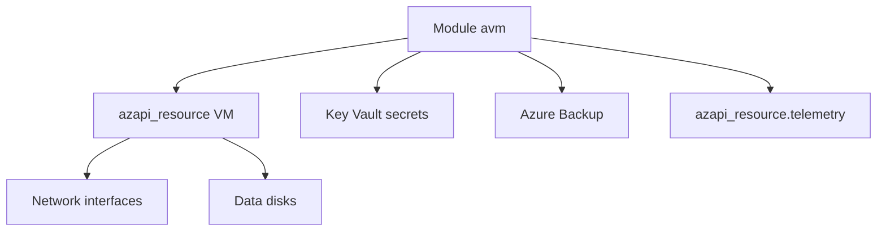

# Azure/terraform-azurerm-avm-res-compute-virtualmachine

> Azure Verified Modules Terraform module that creates Linux or Windows virtual machines, for Azure platform teams.

## The problem
A properly configured Azure VM involves a disk, a network card, credentials, backup and locks, all to be repeated without error.

## What it actually does
Creates Linux or Windows VMs, data disks, network interfaces, public IPs, shutdown schedules, backup, locks and roles. Admin credentials can be generated and stored in Key Vault. A one-time migration (`avm_managed_migration_enabled`) adopts the old secrets.

## How it is wired
Simplified diagram based on the sheet, no diagram provided.


## Trying it
```bash
# Aucune commande dans le README ; seul un exemple HCL d'activation de la migration est fourni :
# avm_managed_migration_enabled = true
```

## Cost and gotchas
Terraform >= 1.16 is required, on purpose. The azurerm provider must remain configured until the secrets are migrated. Retained backup points may continue to be billed. Telemetry is included.

## What it is not
Not a fleet management tool nor a script: a module that requires a good command of Terraform and Azure.

## Alternatives
No alternative named in the README.

## For you
Worth watching if you provision compute VMs on Azure with Terraform; otherwise skip it.
