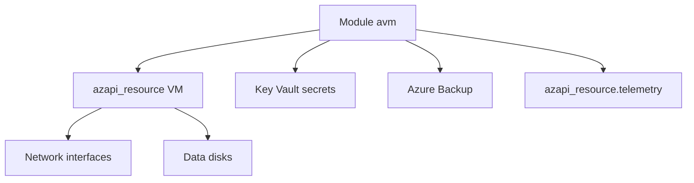

# Azure/terraform-azurerm-avm-res-compute-virtualmachine

> Module Terraform Azure Verified Modules qui crée des machines virtuelles Linux ou Windows, pour les équipes plateforme Azure.

## Le problème
Une VM Azure bien configurée implique disque, carte réseau, identifiants, sauvegarde et verrous, à répéter sans erreur.

## Ce que ça fait vraiment
Crée VM Linux ou Windows, disques de données, interfaces réseau, IP publiques, planning d'arrêt, sauvegarde, verrous et rôles. Les identifiants admin peuvent être générés et rangés dans Key Vault. Une migration unique (`avm_managed_migration_enabled`) adopte les anciens secrets.

## Comment c'est branché
Schéma simplifié d'après la fiche, sans diagramme fourni.


## Essayer
```bash
# Aucune commande dans le README ; seul un exemple HCL d'activation de la migration est fourni :
# avm_managed_migration_enabled = true
```

## Coût et pièges
Terraform >= 1.16 exigé, volontairement. Le fournisseur azurerm doit rester configuré jusqu'à la migration des secrets. Les points de sauvegarde conservés peuvent continuer à être facturés. Télémétrie incluse.

## Ce que ce n'est pas
Pas un outil de gestion de flotte ni un script : un module qui exige une bonne maîtrise de Terraform et d'Azure.

## Alternatives
Aucune alternative nommée dans le README.

## Pour toi
À surveiller si tu provisionnes des VM de calcul sur Azure en Terraform ; à écarter sinon.

