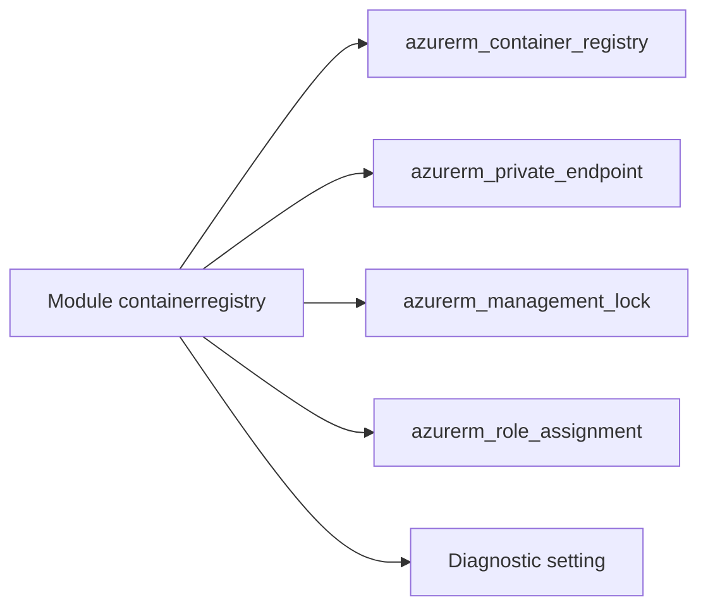

# Azure/terraform-azurerm-avm-res-containerregistry-registry

> Azure Verified Modules Terraform module for deploying an Azure container registry.

## The problem
A secure Azure Container Registry requires many associated resources: locks, private endpoints, roles, diagnostics.

## What it actually does
The module creates an `azurerm_container_registry` with geo-replication, cache rules, credential sets, customer-managed key, private endpoints, locks, roles and diagnostic settings. The README describes migration from the old `resource` output and to the `AbacRepositoryPermissions` mode.

## How it is wired
Simplified diagram based on the sheet, no diagram provided.



## Trying it
```hcl
# Aucun exemple complet dans l'extrait de README ; variables requises :
# location, name, resource_group_name
```

## Cost and gotchas
You need an Azure subscription, Terraform 1.8 or later, azapi ~> 2.12 and azurerm 4.81 or later. The module is at version 0.y.z: anything may change. Telemetry is on by default (`enable_telemetry`).

## What it is not
It is not a stable release: the README warns it should not be considered stable before 1.0.0. Azure Policy can cause configuration drift.

## Alternatives
No alternative named in the README.

## For you
Ignore: an Azure infrastructure module at version 0.y.z, only useful if you administer an ACR registry yourself.
