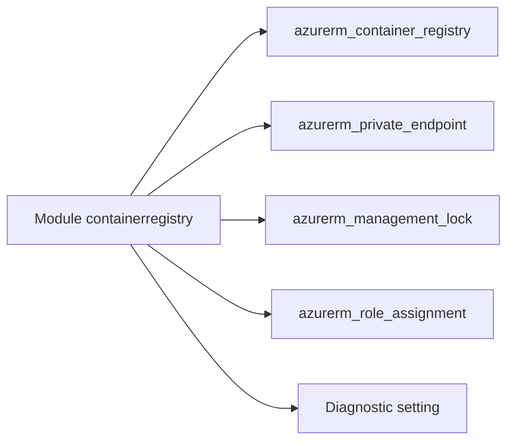

# Azure/terraform-azurerm-avm-res-containerregistry-registry

> Module Terraform Azure Verified Modules pour déployer un registre de conteneurs Azure.

## Le problème
Un Azure Container Registry sécurisé demande beaucoup de ressources associées : verrous, endpoints privés, rôles, diagnostics.

## Ce que ça fait vraiment
Le module crée un `azurerm_container_registry` avec géoréplication, règles de cache, jeux d'identifiants, clé gérée par le client, endpoints privés, verrous, rôles et paramètres de diagnostic. Le README décrit la migration depuis l'ancienne sortie `resource` et vers le mode `AbacRepositoryPermissions`.

## Comment c'est branché
Schéma simplifié d'après la fiche, sans diagramme fourni.



## Essayer
```hcl
# Aucun exemple complet dans l'extrait de README ; variables requises :
# location, name, resource_group_name
```

## Coût et pièges
Il faut un abonnement Azure, Terraform 1.8 ou plus, azapi ~> 2.12 et azurerm 4.81 ou plus. Le module est en version 0.y.z : tout peut changer. La télémétrie est active par défaut (`enable_telemetry`).

## Ce que ce n'est pas
Ce n'est pas une version stable : le README prévient qu'elle n'est pas à considérer comme telle avant la 1.0.0. L'Azure Policy peut provoquer une dérive de configuration.

## Alternatives
Aucune alternative nommée dans le README.

## Pour toi
À ignorer : module d'infrastructure Azure en version 0.y.z, utile seulement si tu administres toi-même un registre ACR.

