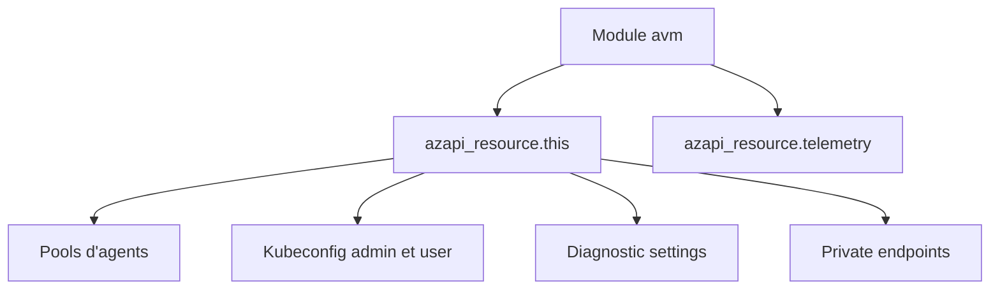

# Azure/terraform-azurerm-avm-res-containerservice-managedcluster

> Azure Verified Modules Terraform module that deploys a managed AKS Kubernetes cluster, for platform teams on Azure.

## The problem
An AKS cluster requires dozens of settings (pools, identity, network, addons) that are hard to keep consistent from one environment to the next.

## What it actually does
Creates the cluster through the `azapi` provider: agent pools, AAD profile, addons (Azure Policy, Key Vault Secrets Provider, OMS agent, Application Gateway), locks, private endpoints, roles and diagnostic settings. Pools inherit `kubernetes_version` unless `orchestrator_version` is set explicitly.

## How it is wired
Simplified diagram based on the sheet, no diagram provided.


## Trying it
```bash
# Aucune commande dans le README : seules les entrées et ressources sont listées.
```

## Cost and gotchas
Terraform >= 1.11 and azapi ~> 2.12 required; the AKS cluster is billed by Azure. The module contains a telemetry resource. Follow the migration guide before upgrading versions.

## What it is not
Not a turnkey tool: the README is mostly a reference of generated inputs. No usage example or command.

## Alternatives
No alternative named in the README.

## For you
Worth watching if you run ML workloads on AKS with Terraform; otherwise it is generic infrastructure with no direct link to data.
