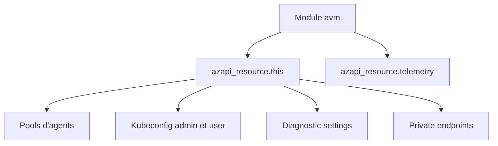

# Azure/terraform-azurerm-avm-res-containerservice-managedcluster

> Module Terraform Azure Verified Modules qui déploie un cluster Kubernetes managé AKS, pour les équipes plateforme sur Azure.

## Le problème
Un cluster AKS demande des dizaines de réglages (pools, identité, réseau, addons) difficiles à tenir cohérents d'un environnement à l'autre.

## Ce que ça fait vraiment
Crée le cluster via le fournisseur `azapi` : pools d'agents, profil AAD, addons (Azure Policy, Key Vault Secrets Provider, OMS agent, Application Gateway), verrous, endpoints privés, rôles et paramètres de diagnostic. Les pools héritent de `kubernetes_version` sauf `orchestrator_version` explicite.

## Comment c'est branché
Schéma simplifié d'après la fiche, sans diagramme fourni.


## Essayer
```bash
# Aucune commande dans le README : seules les entrées et ressources sont listées.
```

## Coût et pièges
Terraform >= 1.11 et azapi ~> 2.12 requis ; le cluster AKS est facturé par Azure. Le module contient une ressource de télémétrie. Suivre le guide de migration avant de monter de version.

## Ce que ce n'est pas
Pas un outil clé en main : le README est surtout un référentiel d'entrées générées. Aucun exemple d'usage ni commande.

## Alternatives
Aucune alternative nommée dans le README.

## Pour toi
À surveiller si tu opères des charges ML sur AKS avec Terraform ; sinon c'est de l'infra générique sans lien direct avec la donnée.

