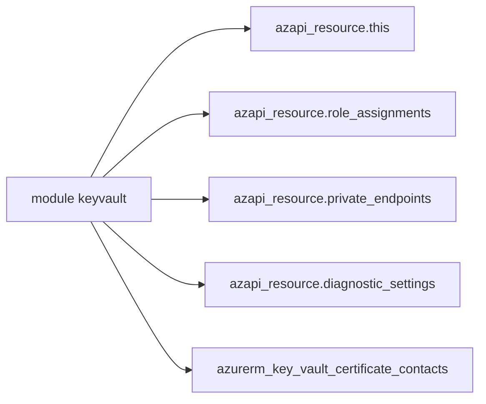

# Azure/terraform-azurerm-avm-res-keyvault-vault

> Azure Verified Modules Terraform module that deploys a Key Vault, its keys and its secrets.

## The problem
A truly secure Key Vault requires locks, networking, roles, private endpoints and diagnostics, all to be written by hand.

## What it actually does
Deploys the vault with the AzAPI provider, plus locks, roles, diagnostic settings and private endpoints. Keys, secrets and certificate contacts remain managed by AzureRM. By default, the vault firewall blocks access. The README devotes a long section to migrating from the 0.12.x versions.

## How it is wired
Simplified diagram based on the sheet, no diagram provided.



## Trying it
```hcl
parent_id = "/subscriptions/<subscription-id>/resourceGroups/<resource-group-name>"
```
No install command in the part read; migration goes through `terraform init -upgrade` then `terraform plan`.

## Cost and gotchas
Azure account required; Terraform 1.11 or later. Telemetry is on by default (`enable_telemetry = true`) and creates empty Azure deployments. Upgrading requires manual `import` in three cases.

## What it is not
It is not a secrets management tool: it does not create the resource group. A `ReadOnly` lock blocks its upgrade.

## Alternatives
No alternative named in the README.

## For you
Worth watching: a clean reference for storing the secrets of an AI platform on Azure, but migrating from 0.12 is delicate.
