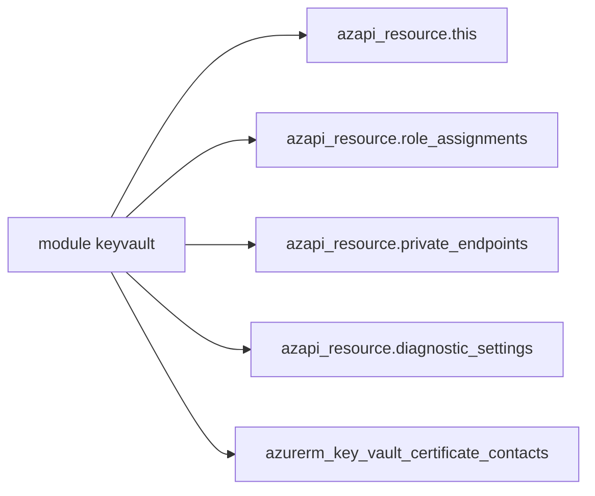

# Azure/terraform-azurerm-avm-res-keyvault-vault

> Module Terraform Azure Verified Modules qui déploie un Key Vault, ses clés et ses secrets.

## Le problème
Un Key Vault réellement sûr demande verrous, réseau, rôles, points de terminaison privés et diagnostics, à écrire à la main.

## Ce que ça fait vraiment
Déploie le coffre avec le provider AzAPI, plus les verrous, rôles, paramètres de diagnostic et endpoints privés. Clés, secrets et contacts de certificats restent gérés par AzureRM. Par défaut, le pare-feu du coffre bloque l'accès. Le README consacre une longue section à la migration depuis les versions 0.12.x.

## Comment c'est branché
Schéma simplifié d'après la fiche, sans diagramme fourni.



## Essayer
```hcl
parent_id = "/subscriptions/<subscription-id>/resourceGroups/<resource-group-name>"
```
Aucune commande d'installation dans la partie lue ; la migration passe par `terraform init -upgrade` puis `terraform plan`.

## Coût et pièges
Compte Azure requis ; Terraform 1.11 ou plus. La télémétrie est active par défaut (`enable_telemetry = true`) et crée des déploiements Azure vides. La mise à niveau demande des `import` manuels dans trois cas.

## Ce que ce n'est pas
Ce n'est pas un outil de gestion de secrets : il ne crée pas le groupe de ressources. Un `ReadOnly` lock bloque sa mise à niveau.

## Alternatives
Aucune alternative nommée dans le README.

## Pour toi
À surveiller : référence propre pour stocker les secrets d'une plateforme IA sur Azure, mais la migration depuis 0.12 est délicate.

