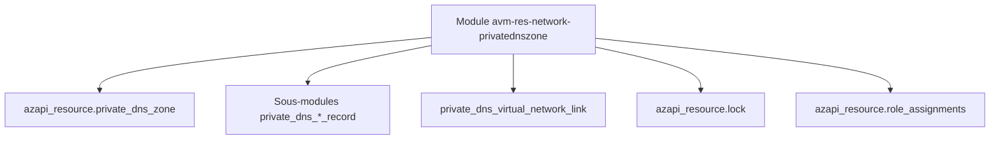

# Azure/terraform-azurerm-avm-res-network-privatednszone

> Terraform Azure Verified Module that creates and manages Azure private DNS zones.

## The problem
Creating private DNS zones by hand, with their records, network links and locks, is repetitive and error-prone.

## What it actually does
The module creates the zone through the azapi provider, with A, AAAA, CNAME, MX, PTR, SRV and TXT records, virtual network links, locks and role assignments. It adds an optional SOA record and adjustable timeouts.

## How it is wired


## Trying it
```bash
module "azure_privatednszone" {
  source = "./path_to_this_module"
  domain_name = "your.domain.com"
  location    = "eastus"
  parent_id   = "/subscriptions/00000000-0000-0000-0000-000000000000/resourceGroups/myResourceGroup"
}
```

## Cost and gotchas
Terraform 1.9 or later, azapi provider. Telemetry is enabled by default and requires permissions on subscription-level deployments; `enable_telemetry = false` turns it off.

## What it is not
Not a multi-cloud module: Azure only. A `terraform plan` after deployment may report an output change without modifying the infrastructure.

## Alternatives
No alternative named in the README.

## For you
Ignore: useful only if you manage Azure networking with Terraform, which is outside the data and AI scope.
