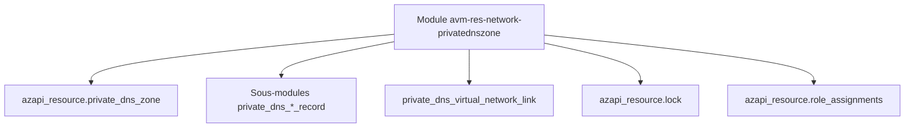

# Azure/terraform-azurerm-avm-res-network-privatednszone

> Module Terraform Azure Verified Module qui crée et gère des zones DNS privées Azure.

## Le problème
Créer des zones DNS privées avec leurs enregistrements, liens réseau et verrous à la main est répétitif et sujet aux erreurs.

## Ce que ça fait vraiment
Le module crée la zone via le provider azapi, avec enregistrements A, AAAA, CNAME, MX, PTR, SRV et TXT, liens de réseau virtuel, verrous et attributions de rôles. Il ajoute un enregistrement SOA optionnel et des délais d'expiration réglables.

## Comment c'est branché


## Essayer
```bash
module "azure_privatednszone" {
  source = "./path_to_this_module"
  domain_name = "your.domain.com"
  location    = "eastus"
  parent_id   = "/subscriptions/00000000-0000-0000-0000-000000000000/resourceGroups/myResourceGroup"
}
```

## Coût et pièges
Terraform 1.9 ou plus, provider azapi. La télémétrie est activée par défaut et exige des droits sur les déploiements au niveau de l'abonnement ; `enable_telemetry = false` la coupe.

## Ce que ce n'est pas
Pas un module multi-cloud : Azure seulement. Un `terraform plan` après déploiement peut signaler un changement de sortie sans modifier l'infrastructure.

## Alternatives
Aucune alternative nommée dans le README.

## Pour toi
À ignorer : utile seulement si tu gères le réseau Azure en Terraform, ce qui reste hors du champ data et IA.

