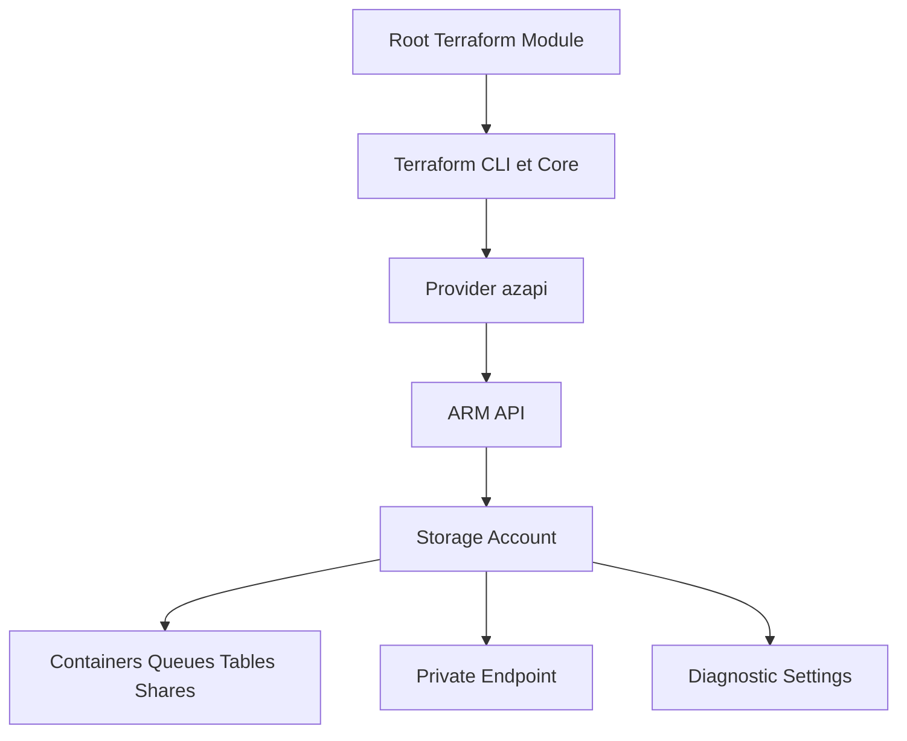

# Azure/terraform-azurerm-avm-res-storage-storageaccount

> Azure Verified Modules Terraform module that creates a storage account and its containers, queues, tables and shares.

## The problem
A secure Azure storage account (keys, private network, diagnostics, roles) is long to write without errors.

## What it actually does
Creates the account via AzAPI, then blob containers, queues, tables, shares, a private endpoint, locks, roles, diagnostics and customer-managed-key encryption. It avoids the shared key by default (`shared_access_key_enabled = false`). Version 0.7.0 requires `moved` blocks to migrate the state.

## How it is wired


## Trying it
```bash
terraform init -upgrade
terraform state pull > terraform-state-backup.json
terraform state list
```

## Cost and gotchas
Storage and traffic are billed by Azure. Major version zero: anything can change. Without `moved`, an upgrade from 0.6.x can destroy resources. Telemetry included (`telemetry` resource).

## What it is not
Not a data transfer or data management tool: it creates the infrastructure. The README also lists an architecture that evokes Data Lake Gen2, whose support is not detailed.

## Alternatives
No alternative named in the README.

## For you
Worth watching if you build a data lake on Azure Storage with Terraform; read the migration from 0.6.x before any version upgrade.
