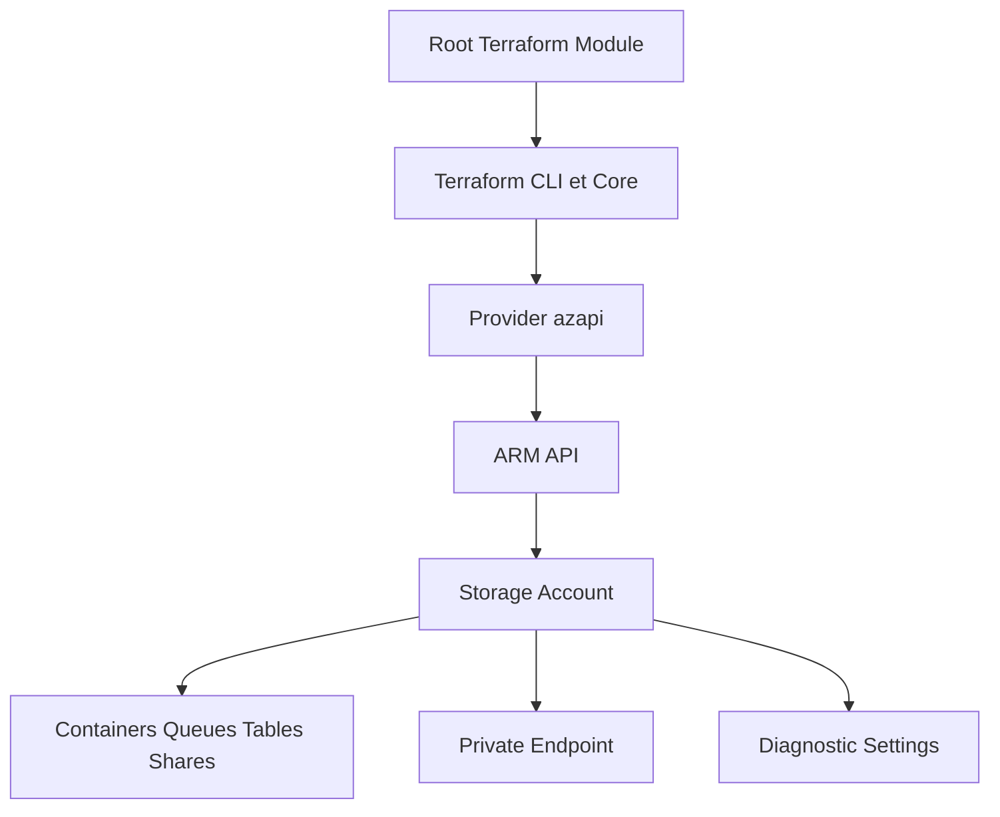

# Azure/terraform-azurerm-avm-res-storage-storageaccount

> Module Terraform Azure Verified Modules qui crée un compte de stockage et ses conteneurs, files, tables et partages.

## Le problème
Un compte de stockage Azure sécurisé (clés, réseau privé, diagnostics, rôles) est long à écrire sans erreur.

## Ce que ça fait vraiment
Crée le compte via AzAPI, puis conteneurs blob, files, tables, partages, point de terminaison privé, verrous, rôles, diagnostics et chiffrement par clé gérée par le client. Il évite la clé partagée par défaut (`shared_access_key_enabled = false`). La version 0.7.0 exige des blocs `moved` pour migrer l'état.

## Comment c'est branché


## Essayer
```bash
terraform init -upgrade
terraform state pull > terraform-state-backup.json
terraform state list
```

## Coût et pièges
Le stockage et le trafic sont facturés par Azure. Version majeure zéro : tout peut changer. Sans `moved`, une mise à jour depuis 0.6.x peut détruire des ressources. Télémétrie incluse (ressource `telemetry`).

## Ce que ce n'est pas
Pas un outil de transfert ou de gestion de données : il crée l'infrastructure. Le README liste aussi une architecture qui évoque Data Lake Gen2, dont la prise en charge n'est pas détaillée.

## Alternatives
Aucune alternative nommée dans le README.

## Pour toi
À surveiller si tu bâtis un lac de données sur Azure Storage en Terraform ; lis la migration depuis 0.6.x avant toute montée de version.

