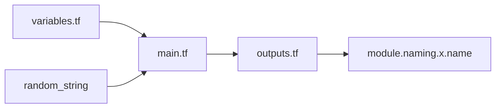

# Azure/terraform-azurerm-naming

> Terraform module that generates consistent names for Azure resources; archived, replaced by Azure Verified Naming Utility.

## The problem
Naming hundreds of Azure resources while respecting lengths, allowed characters and uniqueness, without copy-pasting rules.

## What it actually does
For each `azurerm` resource type, exposes an output with `name`, `name_unique` (random suffix), `slug`, `min_length`, `max_length`, `scope` and `regex`. Configurable prefixes/suffixes. The resources are generated by a Go program from `resourceDefinition.json`.

## How it is wired


## Trying it
```tf
module "naming" {
  source  = "Azure/naming/azurerm"
  suffix = [ "test" ]
}
resource "azurerm_resource_group" "example" {
  name     = module.naming.resource_group.name
  location = "West Europe"
}
```

## Cost and gotchas
Free, but archived: no more updates. Migrate with `legacy_mode = true` to keep the old behavior.

## What it is not
Not maintained. The new module, by default, may produce different names.

## Alternatives
Azure Verified Naming Utility (successor indicated, Terraform registry/GitHub).

## For you
Ignore: archived; if you name Azure resources, start directly from the successor.
