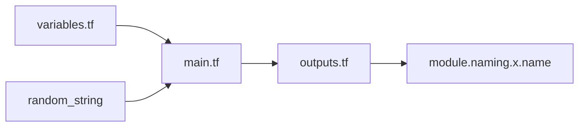

# Azure/terraform-azurerm-naming

> Module Terraform qui génère des noms cohérents pour les ressources Azure ; archivé, remplacé par Azure Verified Naming Utility.

## Le problème
Nommer des centaines de ressources Azure en respectant longueurs, caractères autorisés et unicité, sans copier-coller des règles.

## Ce que ça fait vraiment
Pour chaque type de ressource `azurerm`, expose une sortie avec `name`, `name_unique` (suffixe aléatoire), `slug`, `min_length`, `max_length`, `scope` et `regex`. Préfixes/suffixes configurables. Les ressources sont générées par un programme Go à partir de `resourceDefinition.json`.

## Comment c'est branché


## Essayer
```tf
module "naming" {
  source  = "Azure/naming/azurerm"
  suffix = [ "test" ]
}
resource "azurerm_resource_group" "example" {
  name     = module.naming.resource_group.name
  location = "West Europe"
}
```

## Coût et pièges
Gratuit, mais archivé : plus de mises à jour. Migrer avec `legacy_mode = true` pour garder l'ancien comportement.

## Ce que ce n'est pas
Pas maintenu. Le nouveau module, par défaut, peut produire des noms différents.

## Alternatives
Azure Verified Naming Utility (successeur indiqué, registre Terraform/GitHub).

## Pour toi
À ignorer : archivé ; si tu nommes des ressources Azure, pars directement du successeur.

