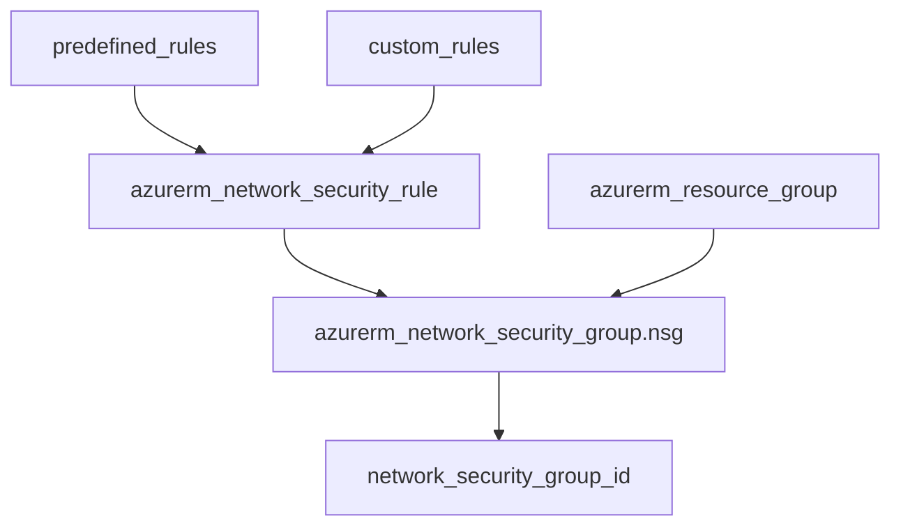

# Azure/terraform-azurerm-network-security-group

> Terraform module creating an Azure network security group with predefined rules, now archived.

## The problem
Writing Azure NSG rules by hand (SSH, HTTP, databases) is repetitive.

## What it actually does
Deploys an `azurerm_network_security_group`, with predefined rules (SSH, HTTP, HTTPS, LDAP, PostgreSQL, Redis, etc.) and custom rules, using `count` or `for_each`. The `network_security_group_id` output applies to a subnet of the Azure network module. It requires azurerm 3.11 or higher and below 4.0.

## How it is wired
Simplified diagram based on the sheet, no diagram provided.



## Trying it
```bash
docker run --rm -v $(pwd):/src -w /src mcr.microsoft.com/azterraform:latest make pre-commit
docker run --rm -v $(pwd):/src -w /src -e TFLINT_CONFIG=.tflint_alt.hcl mcr.microsoft.com/azterraform:latest make pr-check
```

## Cost and gotchas
Azure account and service principal. The commands above are for contributors, not for usage. azurerm constraint below 4.0.

## What it is not
No longer receives updates: the README points to Azure Verified Modules. Not compatible with azurerm 4.

## Alternatives
Azure Verified Modules, mentioned in the README warning.

## For you
Ignore: archived module stuck on azurerm 3; go through Azure Verified Modules.
