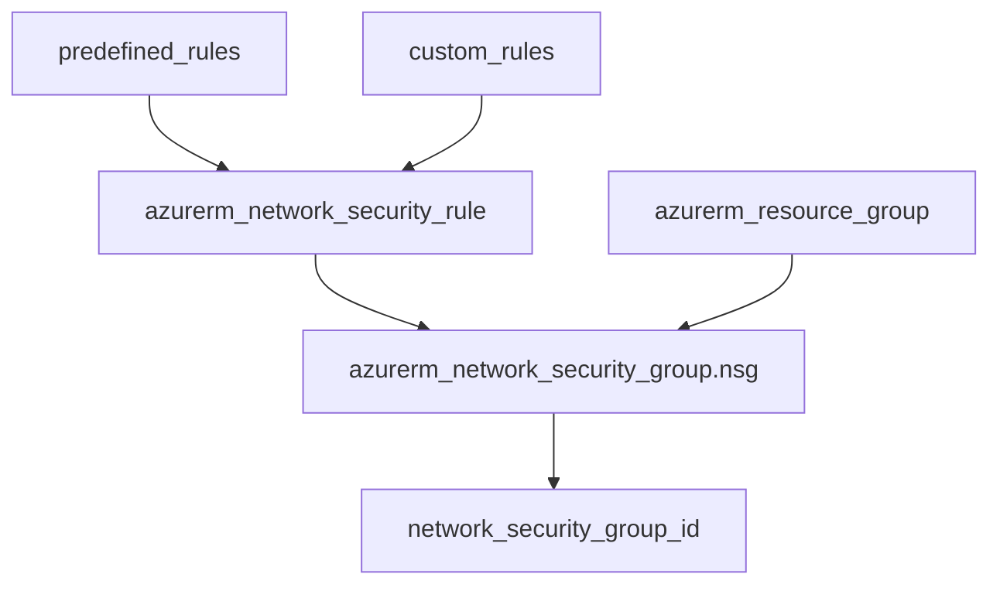

# Azure/terraform-azurerm-network-security-group

> Module Terraform créant un groupe de sécurité réseau Azure avec règles prédéfinies, désormais archivé.

## Le problème
Écrire à la main les règles d'un NSG Azure (SSH, HTTP, bases de données) est répétitif.

## Ce que ça fait vraiment
Déploie un `azurerm_network_security_group`, avec des règles prédéfinies (SSH, HTTP, HTTPS, LDAP, PostgreSQL, Redis, etc.) et des règles personnalisées, en `count` ou `for_each`. La sortie `network_security_group_id` s'applique à un sous-réseau du module réseau Azure. Il exige azurerm 3.11 ou plus et inférieur à 4.0.

## Comment c'est branché
Schéma simplifié d'après la fiche, sans diagramme fourni.



## Essayer
```bash
docker run --rm -v $(pwd):/src -w /src mcr.microsoft.com/azterraform:latest make pre-commit
docker run --rm -v $(pwd):/src -w /src -e TFLINT_CONFIG=.tflint_alt.hcl mcr.microsoft.com/azterraform:latest make pr-check
```

## Coût et pièges
Compte Azure et principal de service. Les commandes ci-dessus servent aux contributeurs, pas à l'usage. Contrainte azurerm inférieure à 4.0.

## Ce que ce n'est pas
Ne reçoit plus de mises à jour : le README renvoie vers Azure Verified Modules. Pas compatible avec azurerm 4.

## Alternatives
Azure Verified Modules, cité dans l'avertissement du README.

## Pour toi
À ignorer : module archivé et bloqué sur azurerm 3 ; passe par Azure Verified Modules.

