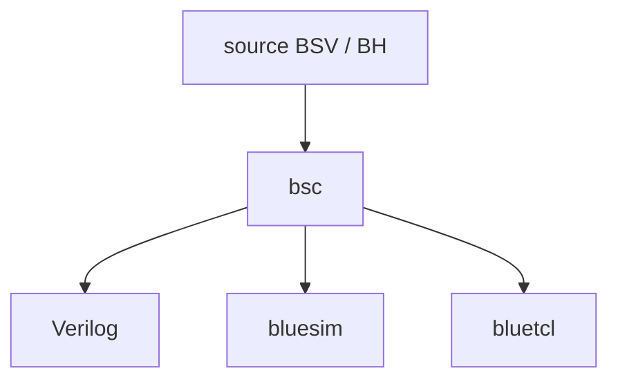

# B-Lang-org/bsc

> Compiler and simulator for the Bluespec hardware description language, for digital circuit designers.

## The problem
Describing hardware in low-level Verilog is error-prone, especially for scheduling.

## What it actually does
`bsc` compiles Bluespec SystemVerilog and Bluespec Haskell to standard Verilog. Its strength is guarded atomic actions: the compiler chooses the scheduling. It includes the bluesim simulator, a standard library and the bluetcl TCL scripting. Developed for nearly twenty years by Bluespec Inc., it has been used for Flute, Piccolo and Shakti.

## How it is wired
Simplified diagram based on the sheet, no diagram provided.

## Trying it
No command in the README: install through a package manager (Homebrew `bsc`, Nix `bluespec`, etc.), or see INSTALL.md.

## Cost and gotchas
Free. Without a package for your system, you must build from source. License shown as BSD 3 by the badge but not identified by GitHub.

## What it is not
Not a general-purpose software tool: it is hardware design. The documentation is in PDF.

## Alternatives
No alternative named in the README.

## For you
Ignore: circuit design, out of scope unless you work on FPGAs or accelerators.
