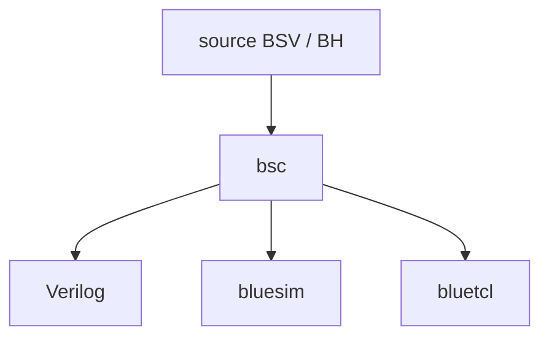

# B-Lang-org/bsc

> Compilateur et simulateur du langage de description matérielle Bluespec, pour concepteurs de circuits numériques.

## Le problème
Décrire du matériel en Verilog bas niveau est source d'erreurs, surtout pour l'ordonnancement.

## Ce que ça fait vraiment
`bsc` compile Bluespec SystemVerilog et Bluespec Haskell vers du Verilog standard. Son atout est les actions atomiques gardées : le compilateur choisit l'ordonnancement. Il inclut le simulateur bluesim, une bibliothèque standard et le scripting TCL bluetcl. Développé près de vingt ans par Bluespec Inc., il a servi pour Flute, Piccolo et Shakti.

## Comment c'est branché
Schéma simplifié d'après la fiche, sans diagramme fourni.

## Essayer
Aucune commande dans le README : installation par gestionnaire de paquets (Homebrew `bsc`, Nix `bluespec`, etc.), ou voir INSTALL.md.

## Coût et pièges
Gratuit. Sans paquet pour ton système, il faut compiler depuis les sources. Licence indiquée BSD 3 par le badge mais non identifiée par GitHub.

## Ce que ce n'est pas
Pas un outil logiciel généraliste : c'est de la conception de matériel. La documentation est en PDF.

## Alternatives
Aucune alternative nommée dans le README.

## Pour toi
Ignorer : conception de circuits, hors périmètre sauf travail sur FPGA ou accélérateurs.

