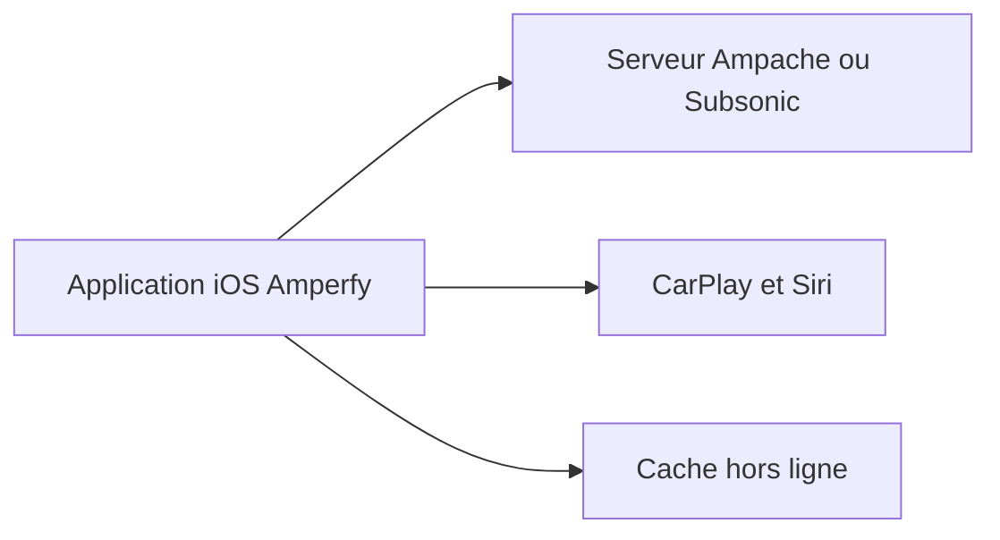

# BLeeEZ/amperfy

> A Swift app for iOS, iPadOS and macOS to listen to music from an Ampache or Subsonic server.

## The problem
Listening to your self-hosted library on Apple devices with offline mode, CarPlay and Siri.

## What it actually does
Swift client for Ampache/Subsonic: multiple accounts, offline mode, CarPlay, gapless playback, music/podcasts/radio, Siri and App Intents, equalizer, replay gain, sleep timer, ratings, scrobbling. Built with Xcode 26 and Swift 6. CarPlay and Siri require a developer certificate with dedicated entitlements to test on a real device.

## How it is wired
Simplified diagram based on the write-up, no diagram provided.



## Trying it
```bash
git clone https://github.com/BLeeEZ/amperfy.git
cd amperfy
# puis ouvrir Amperfy.xcodeproj, build and run le scheme « Amperfy »
```

## Cost and gotchas
Free, but you need an Ampache/Subsonic server and Xcode (Mac). Last push in August 2026.

## What it is not
Not a server: only a client. GPLv3 license, to check if you redistribute derived code.

## Alternatives
No alternative named in the README.

## For you
Ignore: it is a mobile music app unrelated to data or AI, and limited to the Apple ecosystem.
