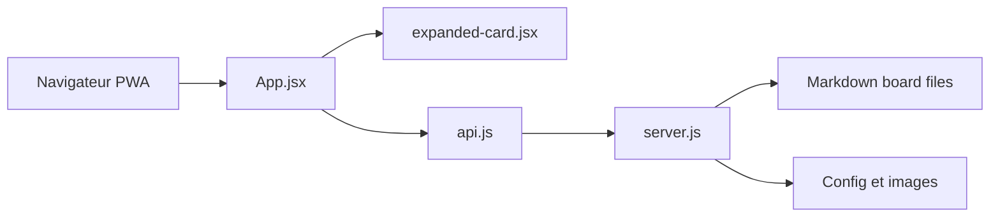

# BaldissaraMatheus/Tasks.md

> Self-hosted task board where each card is a Markdown file and each column a folder.

## The problem
Task management tools lock in your data; you want a simple board that stays readable as a folder of files.

## What it actually does
Web interface (SolidJS) and Koa server: each column is a directory, each task a Markdown file, also editable in Obsidian. Cards, columns and labels, themes (Adwaita, Nord, Catppuccin), multilingual, installable as a PWA, subfolders can be opened as separate projects. A single Docker image is enough.

## How it is wired


## Trying it
```bash
docker run -d \
  --name tasks.md \
  -e PUID=1000 \
  -e PGID=1000 \
  -p 8080:8080 \
  -v /path/to/tasks/:/tasks/ \
  -v /path/to/config/:/config/ \
  --restart unless-stopped \
  baldissaramatheus/tasks.md
```

## Cost and gotchas
Free. Replace the paths with existing folders; PUID/PGID recommended, otherwise files are created as root. The PWA does not work with a `BASE_PATH` other than "/".

## What it is not
Not a rich collaborative tool: a deliberately low-maintenance project with limited features. No authentication is described in the README.

## Alternatives
- No alternative named in the README.

## For you
Keep an eye on it: pleasant for a personal Markdown kanban, unrelated to your data/AI work.
