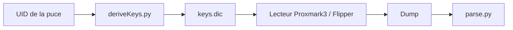

# Bambu-Research-Group/RFID-Tag-Guide

> Research guide on the RFID chips in Bambu Lab filament spools, with small key-derivation scripts.

## The problem
Filament data on Bambu printers is stored in undocumented, encrypted chips.

## What it actually does
Documents the chips' data structures (Bambu, Creality) and provides `deriveKeys.py` (keys derived from the UID), `parse.py` (dump parsing) and key recovery from legacy traces. The chips are RSA-signed: modified data is rejected, but cloning is possible. Reverse-engineered RFID boards (gerbers and BOM).

## How it is wired


## Trying it
```bash
python3 deriveKeys.py [UID] > ./keys.dic
pm3
hf mf dump -k ./keys.dic
script run fm11rf08s_recovery
```

## Cost and gotchas
Free, but a compatible reader (Proxmark3 Iceman, Flipper Zero) is required. No license declared; last push in September 2025.

## What it is not
Not a tool for creating valid chips: the RSA signature prevents it without modified firmware.

## Alternatives
OpenTag3D, an open standard moved to its own repository (mentioned in the README).

## For you
Ignore: reverse engineering of 3D printing hardware, outside data/AI/MLOps and without a license.
