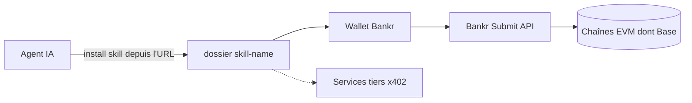

# BankrBot/skills

> Catalog of AI agent skills around the Bankr wallet: swaps, tokens, x402 payments on Base.

## The problem
An AI agent that must act on a blockchain (swap, token deployment, payment) has neither a wallet nor instructions for each protocol.

## What it actually does
One folder per skill, each tied to a provider: Uniswap, Alchemy, Zerion, Clanker, OpenSea, Splits, etc. The agent installs a skill by receiving the URL of its folder. On-chain actions go through the Bankr wallet and its submission API. Many skills are pay-per-call services in USDC (x402), or tokens and betting games specific to the ecosystem.

## How it is wired
Simplified diagram based on the sheet, no diagram provided.


## Trying it
```bash
> install the [skill-name] skill from https://github.com/BankrBot/skills/tree/main/[skill-name]
```

## Cost and gotchas
Many skills charge per call in USDC (x402) or require an API key from the provider. The skills move real money: an agent mistake costs funds.

## What it is not
It is not a code library: it is an index of third-party skills, of uneven quality (one is a mere "placeholder"). No license is declared. The README, truncated in the material provided, does not explain key security.

## Alternatives
No alternative named in the README.

## For you
Ignore for a data / AI / MLOps profile: the universe is crypto finance on Base, outside your field, and without a license.
