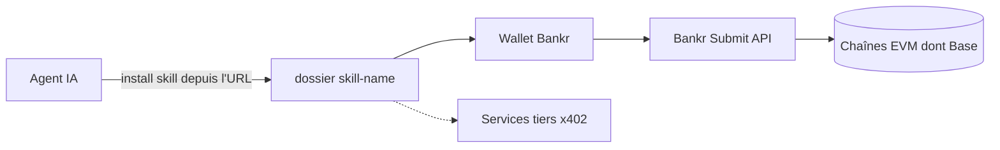

# BankrBot/skills

> Catalogue de skills d'agents IA autour du wallet Bankr : swaps, tokens, paiements x402 sur Base.

## Le problème
Un agent IA qui doit agir sur une blockchain (swap, déploiement de token, paiement) n'a ni wallet ni mode d'emploi pour chaque protocole.

## Ce que ça fait vraiment
Un dossier par skill, chacun lié à un fournisseur : Uniswap, Alchemy, Zerion, Clanker, OpenSea, Splits, etc. L'agent installe un skill en recevant l'URL de son dossier. Les actions on-chain passent par le wallet Bankr et son API de soumission. Beaucoup de skills sont des services payants par appel en USDC (x402), ou des jetons et jeux de paris propres à l'écosystème.

## Comment c'est branché
Schéma simplifié d'après la fiche, sans diagramme fourni.


## Essayer
```bash
> install the [skill-name] skill from https://github.com/BankrBot/skills/tree/main/[skill-name]
```

## Coût et pièges
Beaucoup de skills facturent à l'appel en USDC (x402) ou exigent une clé d'API du fournisseur. Les skills déplacent de l'argent réel : une erreur de l'agent coûte des fonds.

## Ce que ce n'est pas
Ce n'est pas une bibliothèque de code : c'est un index de skills tiers, de qualité inégale (l'un est un simple « placeholder »). Aucune licence n'est déclarée. Le README, tronqué dans la matière fournie, n'explique pas la sécurité des clés.

## Alternatives
Aucune alternative nommée dans le README.

## Pour toi
À ignorer pour un profil data / IA / MLOps : l'univers est la finance crypto sur Base, hors de ton métier, et sans licence.

