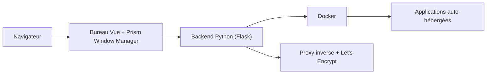

# BansheeTech/HomeDockOS

> Self-hosted web desktop for installing and managing Docker applications, with a built-in file explorer.

## The problem
Installing and supervising dozens of self-hosted applications means manually managing compose, proxy, certificates and ports.

## What it actually does
HomeDock OS presents a desktop in the browser with an app store of more than 800 applications (180 official), a built-in reverse proxy and Let's Encrypt certificates via DNS. It provides a per-application terminal, logs, disk management, an AES-256-GCM encrypted folder, 2FA and document editors. The Enterprise offering adds paid modules; the full version remains free.

## How it is wired
Simplified diagram based on the sheet, no diagram provided.

## Trying it
The README gives no command: the "Getting Started" section is empty in the text provided.

## Cost and gotchas
Free for self-hosting. HomeDock OS code is "source-visible" and not open source; only extracted components (Prism Window Manager under AGPL-3.0, vite-fusion under MIT) are published. Community app stores depend on their maintainers.

## What it is not
Not free software in the OSI sense for the core of the product. The 800 applications are automatically converted from third-party repositories, with no guarantee of compatibility with your processor.

## Alternatives
CasaOS is mentioned as a source of migratable compose files; the README does not present it as an explicit alternative.

## For you
Worth watching: handy for a homelab, but the license needs checking and the core is not open, which matters for professional use.
