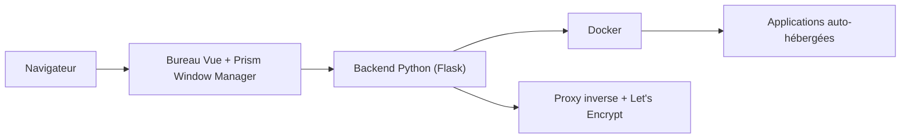

# BansheeTech/HomeDockOS

> Bureau web auto-hébergé pour installer et gérer des applications Docker, avec explorateur de fichiers intégré.

## Le problème
Installer et superviser des dizaines d'applications auto-hébergées demande de gérer à la main compose, proxy, certificats et ports.

## Ce que ça fait vraiment
HomeDock OS présente un bureau dans le navigateur avec une logithèque de plus de 800 applications (180 officielles), un proxy inverse intégré et des certificats Let's Encrypt par DNS. Il fournit terminal par application, journaux, gestion des disques, dossier chiffré en AES-256-GCM, 2FA et éditeurs de documents. L'offre Enterprise ajoute des modules payants ; la version complète reste gratuite.

## Comment c'est branché
Schéma simplifié d'après la fiche, sans diagramme fourni.

## Essayer
Le README ne donne pas de commande : la section « Getting Started » est vide dans le texte fourni.

## Coût et pièges
Gratuit pour l'auto-hébergement. Le code de HomeDock OS est « source-visible » et non open source ; seuls des composants extraits (Prism Window Manager en AGPL-3.0, vite-fusion en MIT) sont publiés. Les logithèques communautaires dépendent de leurs mainteneurs.

## Ce que ce n'est pas
Ce n'est pas un logiciel libre au sens OSI pour le cœur du produit. Les 800 applications sont converties automatiquement de dépôts tiers, sans garantie de compatibilité avec ton processeur.

## Alternatives
CasaOS est mentionné comme source de fichiers compose migrables ; le README ne le présente pas comme alternative explicite.

## Pour toi
À surveiller : pratique pour un homelab, mais la licence est à vérifier et le cœur n'est pas ouvert, ce qui compte pour un usage professionnel.

