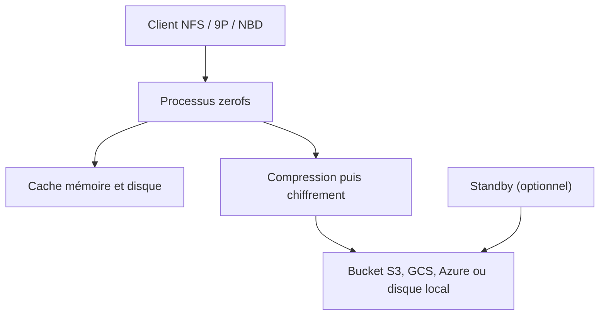

# Barre/ZeroFS

> POSIX file system on top of S3, served over NFS, 9P and as an NBD block device.

## The problem
Storing large volumes on S3 and using it like a normal disk often requires a separate metadata database.

## What it actually does
A single process exposes three servers (NFS, 9P, NBD). Data is compressed (zstd or lz4) then encrypted (XChaCha20-Poly1305) before being sent. Everything is stored in the bucket, with no external database. Optional high availability with a leader and a standby on the same bucket. Web interface included.

## How it is wired
Simplified diagram based on the sheet, no diagram provided.



## Trying it
```bash
curl -sSfL https://sh.zerofs.net | sh
docker pull ghcr.io/barre/zerofs:latest
docker run --rm ghcr.io/barre/zerofs:latest init - > zerofs.toml
sudo mount -t zerofs 127.0.0.1:5564 /mnt/zerofs
```

## Cost and gotchas
S3 storage and requests at your expense; do not use an archive class (the volume becomes unusable) nor infrequent-access (retrieval is billed). Fencing requires conditional writes, otherwise a Redis URL. NFS reports stable writes before durability: prefer 9P if fsync matters.

## What it is not
Not a backup tool. The 16 EiB limits are format limits, not tested. Dual license AGPL v3 and commercial.

## Alternatives
Not documented in the README (it compares itself to "other S3 filesystem projects" without naming them).

## For you
Keep an eye on it: interesting for dataset storage on S3 mounted like a disk, but young (created in 2025), AGPL, and durability depends on the chosen mount mode.
