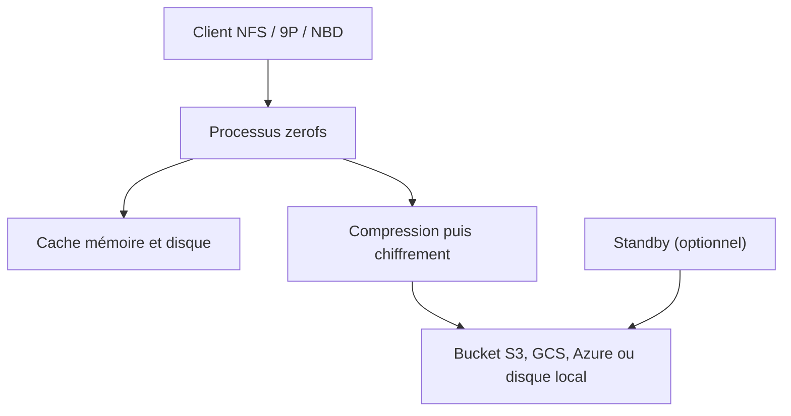

# Barre/ZeroFS

> Système de fichiers POSIX au-dessus de S3, servi en NFS, 9P et périphérique bloc NBD.

## Le problème
Stocker de gros volumes sur S3 en les utilisant comme un disque normal demande souvent une base de métadonnées séparée.

## Ce que ça fait vraiment
Un seul processus expose trois serveurs (NFS, 9P, NBD). Les données sont compressées (zstd ou lz4) puis chiffrées (XChaCha20-Poly1305) avant envoi. Tout est stocké dans le bucket, sans base externe. Haute disponibilité optionnelle avec un leader et un standby sur le même bucket. Interface web incluse.

## Comment c'est branché
Schéma simplifié d'après la fiche, sans diagramme fourni.



## Essayer
```bash
curl -sSfL https://sh.zerofs.net | sh
docker pull ghcr.io/barre/zerofs:latest
docker run --rm ghcr.io/barre/zerofs:latest init - > zerofs.toml
sudo mount -t zerofs 127.0.0.1:5564 /mnt/zerofs
```

## Coût et pièges
Stockage et requêtes S3 à ta charge ; ne pas utiliser de classe archive (volume inutilisable) ni infrequent-access (récupération facturée). Le fencing exige des écritures conditionnelles, sinon une URL Redis. NFS signale des écritures stables avant la durabilité : préférer 9P si fsync compte.

## Ce que ce n'est pas
Pas un outil de sauvegarde. Les limites de 16 EiB sont des limites de format, pas testées. Licence double AGPL v3 et commerciale.

## Alternatives
Non documenté dans le README (il se compare à « d'autres projets de filesystem sur S3 » sans les nommer).

## Pour toi
À surveiller : intéressant pour un stockage de datasets sur S3 monté comme un disque, mais jeune (créé en 2025), AGPL, et la durabilité dépend du mode de montage choisi.

