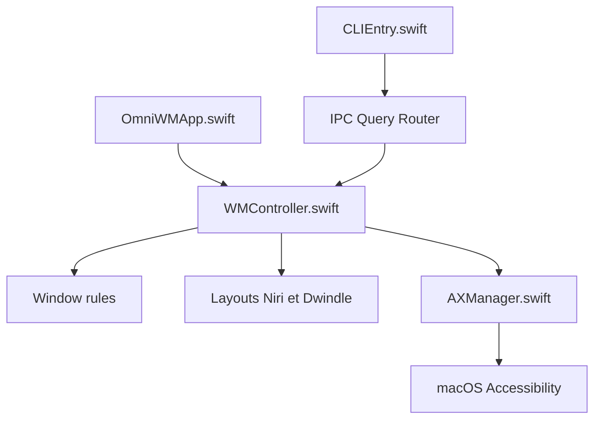

# BarutSRB/Hiro

> Tiling window manager for Apple Silicon Macs running macOS 26 or later (OmniWM).

## The problem
macOS offers neither tiling window management nor keyboard-driven workspaces.

## What it actually does
Two layout engines, chosen per workspace: Niri-style scrolling columns and Hyprland-style binary partitioning (Dwindle). Multi-display routing, command palette, drop-down terminal, clipboard history, and a CLI `omniwmctl` over IPC (disabled by default).

## How it is wired


## Trying it
```bash
brew install --cask omniwm
nix profile install nixpkgs#omniwm
```

## Cost and gotchas
Free. Requires macOS 26, Apple Silicon, the Accessibility and Input Monitoring permissions, and "Displays have separate Spaces" enabled. Uses some private Apple APIs.

## What it is not
Not cross-platform: limited to recent macOS. Nothing to do with a data or AI tool.

## Alternatives
Not documented in the README (it mentions Ice and Caffeine for two features, not as competitors).

## For you
Ignore: a desktop tool unrelated to data, AI or MLOps, unless you are looking for a window manager on macOS 26.
