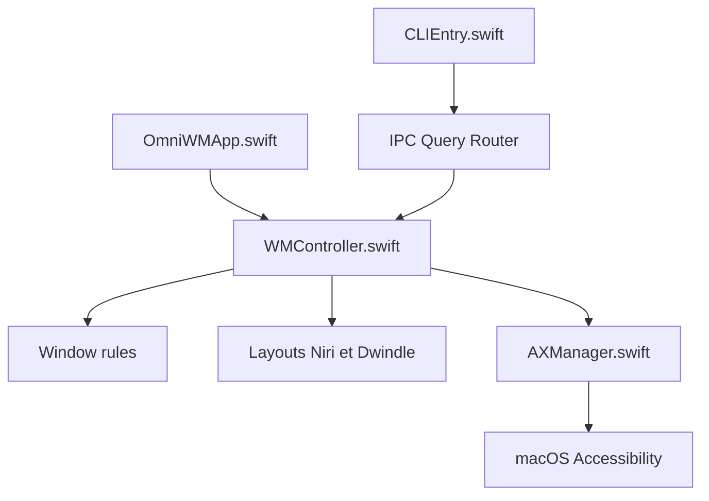

# BarutSRB/Hiro

> Gestionnaire de fenêtres en mosaïque pour Mac Apple Silicon sous macOS 26 ou plus (OmniWM).

## Le problème
macOS ne propose pas de gestion de fenêtres en mosaïque ni de workspaces pilotables au clavier.

## Ce que ça fait vraiment
Deux moteurs de disposition, choisis par workspace : colonnes défilantes de type Niri et partition binaire de type Hyprland (Dwindle). Routage multi-écrans, palette de commandes, terminal escamotable, historique du presse-papiers, et un CLI `omniwmctl` via IPC (désactivé par défaut).

## Comment c'est branché


## Essayer
```bash
brew install --cask omniwm
nix profile install nixpkgs#omniwm
```

## Coût et pièges
Gratuit. Exige macOS 26, Apple Silicon, les permissions Accessibilité et Surveillance de saisie, et « Les écrans ont des Spaces séparés » activé. Utilise certaines API privées d'Apple.

## Ce que ce n'est pas
Pas multiplateforme : réservé à macOS récent. Rien à voir avec un outil de data ou d'IA.

## Alternatives
Non documenté dans le README (il cite Ice et Caffeine pour deux fonctions, pas comme concurrents).

## Pour toi
À ignorer : outil de bureau sans lien avec data, IA ou MLOps, sauf si tu cherches un gestionnaire de fenêtres sous macOS 26.

