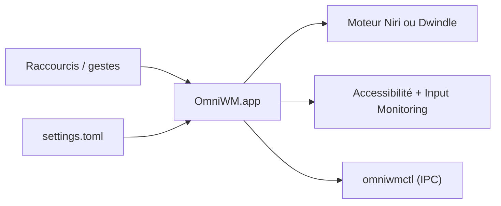

# BarutSRB/OmniWM

> Tiling window manager for Apple Silicon Macs on macOS 26, with Niri or Dwindle layouts.

## The problem
macOS arranges windows poorly across several displays and offers little keyboard-driven layout.

## What it actually does
Two layout engines per workspace: Niri-style scrolling columns and Dwindle binary partitioning. It adds a command palette, window overview, a spaces bar, a Ghostty-based Quake terminal, scratchpads, per-application rules and an `omniwmctl` CLI (IPC disabled by default). Settings live in `settings.toml`.

## How it is wired


## Trying it
```bash
brew install --cask omniwm
```

## Cost and gotchas
Free. Requires Apple Silicon, macOS 26+, Accessibility and Input Monitoring permissions, and "Displays have separate Spaces".

## What it is not
Neither a data/AI tool, nor compatible with Intel or Linux. Some features (hidden bar) require macOS 27.

## Alternatives
- Nehir (cited fork), choru-k/OmniWM: workflow variants of the same project.

## For you
Ignore on the data/AI side: a macOS window manager, useful only if you want keyboard tiling.
