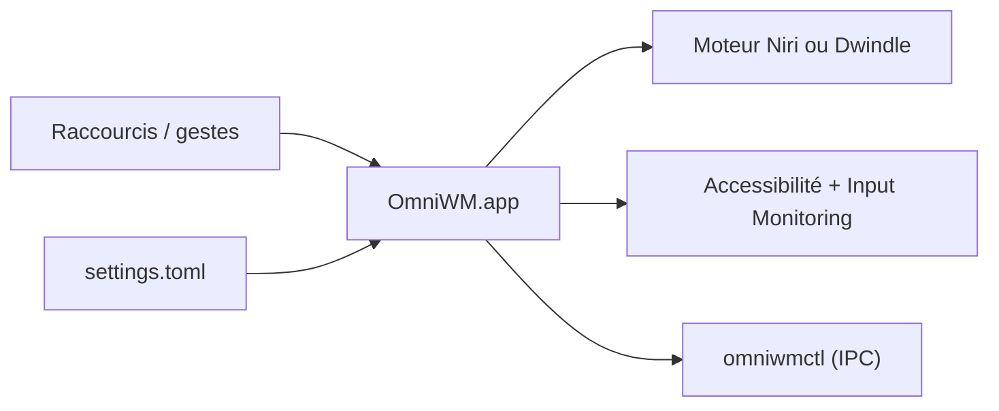

# BarutSRB/OmniWM

> Gestionnaire de fenêtres en mosaïque pour Mac Apple Silicon sous macOS 26, aux dispositions Niri ou Dwindle.

## Le problème
macOS range mal les fenêtres sur plusieurs écrans et propose peu de disposition au clavier.

## Ce que ça fait vraiment
Deux moteurs de disposition par espace de travail : colonnes défilantes de type Niri et partition binaire Dwindle. Il ajoute palette de commandes, aperçu des fenêtres, barre d'espaces, terminal Quake basé sur Ghostty, scratchpads, règles par application et une CLI `omniwmctl` (IPC désactivé par défaut). Réglages dans `settings.toml`.

## Comment c'est branché


## Essayer
```bash
brew install --cask omniwm
```

## Coût et pièges
Gratuit. Exige Apple Silicon, macOS 26+, permissions Accessibilité et Surveillance de saisie, et « Displays have separate Spaces ».

## Ce que ce n'est pas
Ni outil data/IA, ni compatible Intel ou Linux. Certaines fonctions (barre masquée) demandent macOS 27.

## Alternatives
- Nehir (fork cité), choru-k/OmniWM : variantes de workflow pour le même projet.

## Pour toi
À ignorer côté data/IA : gestionnaire de fenêtres macOS, utile seulement si tu cherches un tiling clavier.

