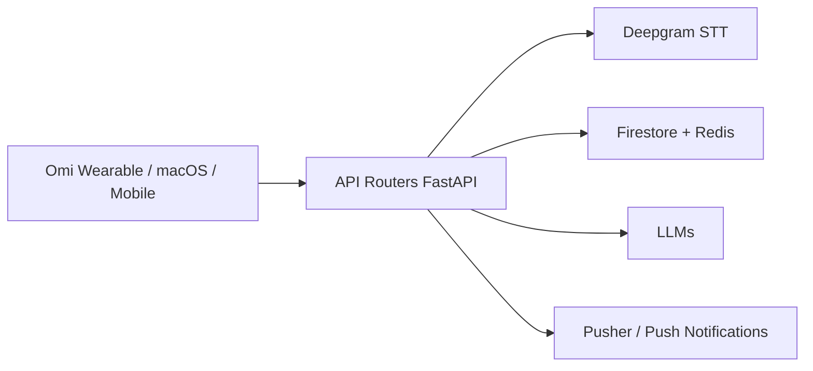

# BasedHardware/omi

> Assistant that captures screen and conversations, transcribes and summarizes them, on desktop, mobile or a connected device.

## The problem
We forget what we saw and said; an AI-searchable memory is needed.

## What it actually does
The Python/FastAPI backend receives audio (REST and WebSocket), transcribes it via Deepgram, analyzes it (VAD and diarization on GPU) and stores it on Firestore and Redis with LLMs. Clients: macOS app (Swift), Windows, Flutter mobile, nRF firmware and ESP32-S3 glasses. SDK, MCP server and API to build apps.

## How it is wired


## Trying it
```bash
git clone https://github.com/BasedHardware/omi.git && cd omi/desktop/macos && ./run.sh --yolo
make setup
```

## Cost and gotchas
The quick mode connects to the cloud backend. A full deployment involves keys and services (Deepgram, LLM, Firebase). 1,164 open issues. Screen and voice capture raise privacy questions.

## What it is not
Not a purely local tool: the default startup goes through the project's cloud.

## Alternatives
No alternative cited in the README.

## For you
Worth watching: a good study of an audio, transcription and LLM pipeline, but heavy to host and sensitive regarding personal data.
