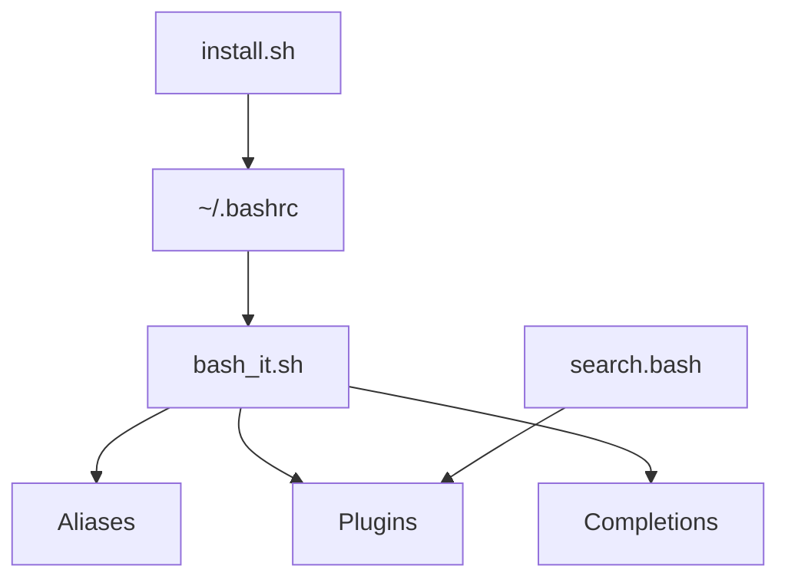

# Bash-it/bash-it

> Framework for Bash: community aliases, plugins, completions and themes, in the spirit of oh-my-zsh.

## The problem
A `.bashrc` that keeps growing without structure, with scattered scripts and aliases.

## What it actually does
A loader (`bash_it.sh`) enables aliases, plugins, completions and themes on demand. A search command lets you enable or disable components, and `bash-it doctor` produces a diagnostic (Bash version, active components, update status). 97% of the code is compatible with Bash 3.2+.

## How it is wired


## Trying it
```bash
git clone --depth=1 https://github.com/Bash-it/bash-it.git ~/.bash_it
~/.bash_it/install.sh
bash-it doctor
```

## Cost and gotchas
Free. The installer modifies `~/.bashrc` (a backup is made if the file exists). A few plugins require Bash 5.

## What it is not
Not a new shell: it stays within Bash. Does not work for zsh.

## Alternatives
oh-my-zsh, from which it is said to be "forked".

## For you
Worth watching: useful if you live in Bash on Linux or WSL, but the gain is cosmetic.
